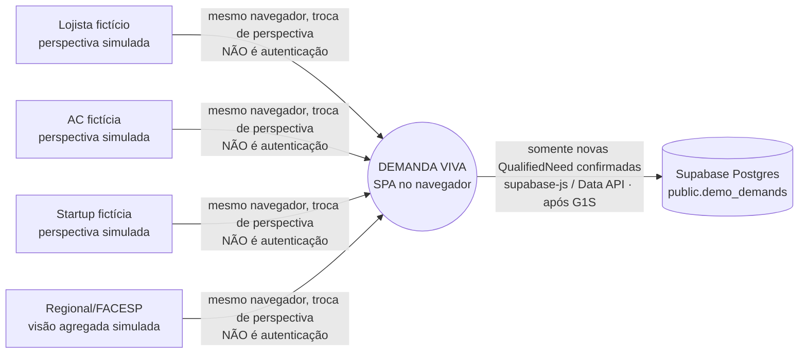
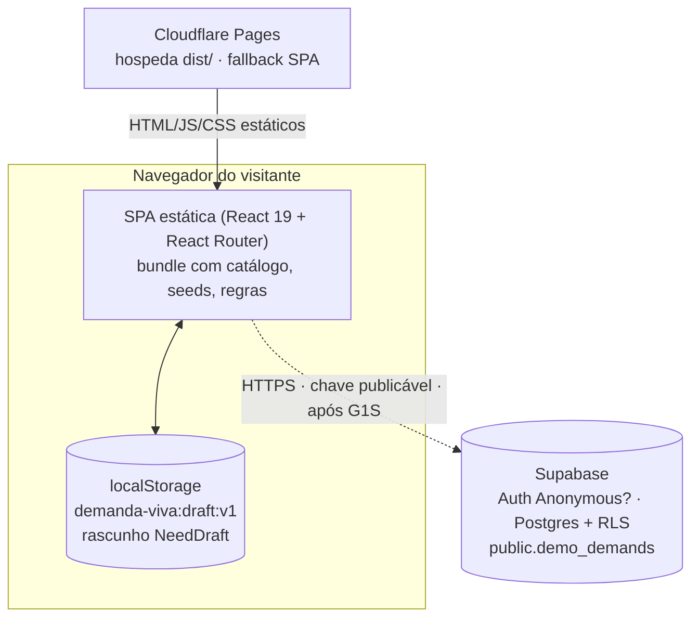
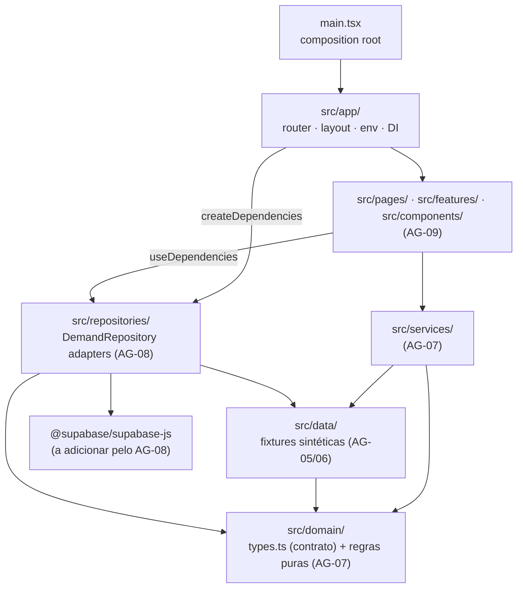

# DEMANDA VIVA — ARCHITECTURE

> **Versão:** 0.1.0 (scaffold) · **Data:** 2026-11-14 · **Autor:** AG-02 (Cursor) · **Natureza:** arquitetura **implementada no scaffold** + fronteiras para os próximos agentes.
> **Entradas:** `PROJECT_CONTEXT.md` v1.1.0, `DATA_MODEL.md` v1.0.0 (aprovado em DEC-APP-G1-20261114), `DECISIONS.md` v1.1.0, `AGENTS.md` v1.1.0, kit `AG-03_BRAND/` (Ponte Viva).
> **Não substitui** os slides C4 conceituais (fonte 04): aqueles mostram papéis e camadas pretendidos; este documento descreve o que existe no repositório e onde cada agente encaixa o restante.

## 1. Estado real

| Item | Situação em 2026-11-14 |
| --- | --- |
| SPA React + TS + Vite, rotas placeholder | **Implementado e testado localmente** (lint, 31 testes unitários, build). |
| Recarregamento de rota profunda | **Verificado no emulador local do Pages** (`wrangler pages dev dist`). Não verificado em URL pública. |
| Tipos do contrato (`src/domain/types.ts`) | **Materializados** da §4 do DATA_MODEL v1.0.0 e compilados. |
| `DemandRepository` | **Somente a porta** + adaptador placeholder que rejeita tudo. Adaptadores reais: AG-08. |
| Catálogo, seeds, cenários | **Não existem.** AG-05/AG-06. |
| Motor de gates/score/briefing/cluster | **Não existe.** AG-07. |
| Supabase (projeto, migração, RLS, Auth) | **Não existe / não aplicado.** AG-08 + decisão G1S. `@supabase/supabase-js` **não** é dependência ainda. |
| Deploy Cloudflare Pages | **Não realizado.** AG-10, com acesso da equipe (PEND-11). |

## 2. C4 lógico

### 2.1 Contexto

Não há API Node própria, ERP real, LLM em tempo real nem geração de software. Todos os atores são personagens da demonstração.

### 2.2 Contêineres

- **Cloudflare Pages** só serve arquivos estáticos de `dist/`. Sem Pages Functions.
- **Supabase** é opcional em runtime: sem `VITE_SUPABASE_*` (ou sem adaptador), a SPA roda em **modo local** e exibe "Modo offline: novas demandas não serão compartilhadas entre navegadores."

### 2.3 Componentes (dentro da SPA)

Setas = "importa". Nenhuma seta aponta para fora de `domain/`.

## 3. Estrutura de diretórios e propriedade

| Caminho | Dono primário | Conteúdo |
| --- | --- | --- |
| `index.html`, `vite.config.ts`, `tsconfig*.json`, `eslint.config.js`, `package.json` | AG-02 | Build, lint, testes. Mudanças de toolchain → AG-02/AG-10. |
| `src/main.tsx`, `src/app/` | AG-02 | Composition root, router, layout mínimo, env, DI. AG-09 troca `element` das rotas; AG-08 troca o repositório em `createDependencies.ts`. |
| `src/app/routes.ts` | AG-02 → AG-04/AG-09 | Inventário único de rotas (provisório até `docs/UX_FLOW.md`). |
| `src/domain/types.ts` | AG-01 (contrato) | Cópia da §4 do DATA_MODEL. Não editar sem decisão. |
| `src/domain/*` (demais) | AG-07 | Gates, score, briefing, cluster, validadores. |
| `src/services/` | AG-07 | API de serviço tipada para a UI. |
| `src/data/` | AG-05 (catálogo), AG-06 (ACs, seeds, cenários) | Fixtures **sintéticas** embarcadas. |
| `src/repositories/` | AG-08 | `StaticSeed`, `Supabase`, `Composite` + mappers. |
| `src/pages/`, `src/features/`, `src/components/` | AG-09 | Telas, fluxos, componentes. |
| `src/styles/brand-tokens.css` | AG-03 | Cópia fiel de `AG-03_BRAND/tokens.css`. |
| `src/styles/base.css` | AG-02 → AG-09 | Reset e layout mínimo. |
| `public/brand/` | AG-03 | `logo-horizontal.svg`, `logo-compact.svg`, `favicon.svg` copiados sem alteração. |
| `supabase/migrations/` | AG-08 | SQL versionado. Vazio. |
| `tests/<camada>/` | dono da camada | Ver `tests/README.md`. |
| `tests/fixtures/` | AG-06 | Dados apenas de teste (D/E), fora do bundle. |
| `scripts/` | AG-02/AG-10 | `verify-spa-build.mjs`, `repo-guards.mjs`. |
| `docs/` | AG-00 (governança), AG-01 (DATA_MODEL), AG-02 (ARCHITECTURE), AG-04 (UX_FLOW), AG-10 (QA_REPORT) | — |

Cada pasta de `src/` tem um `README.md` com dono, arquivos esperados e regras locais.

## 4. Fronteiras (impostas por ferramenta quando possível)

| Regra | Como é verificada |
| --- | --- |
| `src/domain/` não importa React, Supabase nem outras camadas | ESLint `no-restricted-imports` |
| `src/data/` e `src/services/` não importam React, Supabase, repositórios ou UI | ESLint `no-restricted-imports` |
| UI (`pages/features/components`) nunca importa `@supabase/*` | ESLint `no-restricted-imports` |
| UI obtém persistência só via `useDependencies().demandRepository` | Revisão + regra acima |
| Nenhum segredo em `src/`, `tests/`, `supabase/`, `.env.example`, `dist/` | `tests/guards/repository-hygiene.test.ts` + `scripts/verify-spa-build.mjs` |
| Fixtures em `src/data/` sem padrões de PII (CPF, CNPJ, e-mail, telefone) | `tests/guards/repository-hygiene.test.ts` |
| `.env.example` declara apenas `VITE_SUPABASE_URL` e `VITE_SUPABASE_PUBLISHABLE_KEY`, vazios | Teste de guarda |
| Chave `sb_secret_…` ou JWT `role=service_role` em `VITE_SUPABASE_PUBLISHABLE_KEY` é recusada em runtime | `src/app/env.ts` + `tests/app/env.test.ts` |
| `dist/404.html` não pode existir (desativaria o fallback SPA do Pages) | `scripts/verify-spa-build.mjs` (roda dentro de `npm run build`) |

## 5. Injeção de dependência e repositórios

- Porta: `DemandRepository { save, list, get }` e `PersistenceState` — definidos no contrato (`src/domain/types.ts`).
- Container: `AppDependencies { demandRepository, runtime, remoteSharingEnabled }` em `src/app/dependencies.ts`; provido por `DependenciesProvider`; consumido com `useDependencies()`.
- Montagem: `src/app/createDependencies.ts` (único lugar que escolhe adaptadores).
- Scaffold atual: `createUnconfiguredDemandRepository()` **rejeita** `save/list/get` com `RepositoryNotConfiguredError`, para que nenhuma tela mostre contagem ou "salvo na nuvem" sem adaptador real. `remoteSharingEnabled` é `false`.
- Alvo (AG-08, DATA_MODEL §9): `CompositeDemandRepository(StaticSeedRepository, SupabaseDemandRepository)`; `save()` delega ao remoto e só resolve após confirmação do servidor; `list/get` mesclam com dedupe por UUID (seed vence colisão), ordem `createdAt ASC, id ASC`.
- Testes de UI podem injetar repositórios falsos via `DependenciesProvider` sem tocar no composition root.

## 6. Configuração e segredos

| Variável | Onde | Observação |
| --- | --- | --- |
| `VITE_SUPABASE_URL` | `.env.local` (local) / variáveis do projeto Pages (produção e preview) | `https://…`; `http://` só para localhost. |
| `VITE_SUPABASE_PUBLISHABLE_KEY` | idem | Chave **publicável** (`sb_publishable_…`) ou anon legada. Vai para o bundle, pública por definição. |

Nunca: `service_role`, `sb_secret_…`, connection string, senhas. Variáveis `VITE_*` são embutidas **no momento do build**: alterá-las no Pages exige novo deploy.

## 7. Build, roteamento e hospedagem

- `npm run build` = `tsc -b` → `vite build` → `scripts/verify-spa-build.mjs`; saída em `dist/`.
- Roteamento: `createBrowserRouter` (URLs limpas, sem `#`). O Cloudflare Pages, **sem `404.html` na raiz da saída**, serve `index.html` para qualquer caminho que não seja asset ([docs: Serving Pages → SPA rendering](https://developers.cloudflare.com/pages/configuration/serving-pages/#single-page-application-spa-rendering)). Por isso **não** usamos `_redirects`, e a rota `*` da SPA mostra "Página não encontrada".
- Node: `.node-version` = `22` (padrão do build image v3 do Pages; o v3 **não** lê `engines`).
- Fonte Manrope servida localmente via `@fontsource/manrope` (subset latino 400/600/800, licença SIL OFL), sem CDN de terceiros.

## 8. Decisões técnicas do AG-02 (propostas, dentro do escopo)

| ID | Decisão | Motivo | Estado |
| --- | --- | --- | --- |
| AD-02-01 | React 19, React Router 8 (modo data router), Vite 8, TypeScript 6 estrito (`exactOptionalPropertyTypes`, `noUncheckedIndexedAccess`) | Versões estáveis atuais; tipos discriminados do contrato dependem de modo estrito | Proposta AG-02 |
| AD-02-02 | Vitest + Testing Library + jsdom; testes em `tests/` espelhando `src/` | Mesma config do Vite; pastas por dono evitam colisão | Proposta AG-02 |
| AD-02-03 | ESLint flat config com fronteiras de camada via `no-restricted-imports` | Torna a propriedade de pastas verificável | Proposta AG-02 |
| AD-02-04 | Fallback SPA nativo do Pages (sem `_redirects`, sem `404.html`) + verificação pós-build | Comportamento documentado; evita regra redundante | Proposta AG-02 |
| AD-02-05 | Repositório placeholder que **rejeita** em vez de devolver lista vazia | Lista vazia induziria contagem falsa ("0 demandas") | Proposta AG-02 |
| AD-02-06 | Sem `@supabase/supabase-js` e sem validador de schema (Zod etc.) no scaffold | Escolhas de AG-08 (persistência) e AG-07/08 (validação runtime exigida pelo DATA_MODEL §4) | Proposta AG-02 |
| AD-02-07 | Rotas provisórias em `src/app/routes.ts` (9 rotas + 404) | AG-04 ainda não entregou `UX_FLOW.md`; inventário único facilita a troca | Provisória |

Nenhuma dessas decisões altera contrato, pesos, gates, persistência ou segurança aprovados. Decisões de produto continuam em `DECISIONS.md`.

## 9. Rotas placeholder

| Path | Perspectiva | Tela futura (AG-09) |
| --- | --- | --- |
| `/` | — | Início e escolha de perspectiva (simulada) |
| `/lojista/diagnostico` | Lojista | Entrevista guiada → `NeedDraft` local → `QualifiedNeed` |
| `/lojista/resultado/:needId` | Lojista | Resultado A / B / C |
| `/briefing/:needId` | — | Minuta de briefing técnico |
| `/ac/painel` | AC | Seeds + remotos deduplicados, contagem real |
| `/ac/clusters/:clusterId` | AC | Similaridade sugerida, revisão simulada |
| `/startup/chamadas` | Startup | Lista de chamadas simuladas |
| `/startup/chamadas/:callId` | Startup | Chamada e resposta simulada |
| `/regional` | Regional/FACESP | Agregados sintéticos |
| `*` | — | Página não encontrada (dentro da SPA) |

O layout exibe sempre: aviso de demonstração com dados fictícios, aviso de que trocar de perspectiva **não é login nem autorização**, e o banner de modo offline enquanto `remoteSharingEnabled` for `false`.

## 10. Riscos técnicos registrados pelo AG-02

| Risco | Relação | Mitigação |
| --- | --- | --- |
| Inconsistência documental: cabeçalho do `DATA_MODEL.md` local ainda diz "não aprovado"; `DECISIONS.md` registra aprovação | R-03 | AG-02 seguiu `DECISIONS.md` (DEC-APP-G1-20261114). AG-00 deve atualizar o cabeçalho ou registrar nota. |
| `npm audit`: 7 vulnerabilidades **moderadas** em `minimatch` via `typescript-eslint` (só ferramenta de lint, fora do bundle) | — | Não usar `audit fix --force` (faz downgrade). Reavaliar quando `typescript-eslint` publicar correção. |
| Fallback SPA do Pages devolve `index.html` (200) também para asset inexistente (ex.: chunk antigo após deploy) | R-07 | Assets têm hash no nome; aceitar recarregamento. AG-10 inclui no smoke. |
| Cloudflare recomenda Workers (static assets) para projetos novos; a decisão vigente é Pages (DEC-ARCH-001) | R-13 | Manter Pages. Migração só por nova decisão da equipe. |
| Rotas podem divergir do UX final do AG-04 | R-11 | Inventário único em `routes.ts`; testes iteram sobre ele. |
| Logo SVG usa `<text>` com Manrope; em `` o navegador usa fonte de fallback | — | Já apontado pelo AG-03; exportar em contornos após aprovação. |
| Deploy, URL pública e refresh em produção não verificados | R-07, BLK-05 | AG-10 com acesso Cloudflare. |
