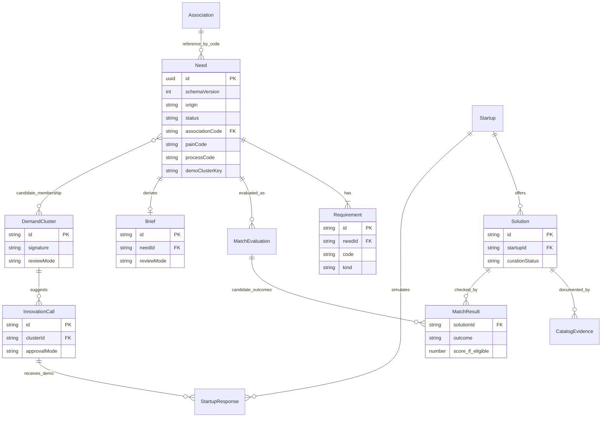

# DEMANDA VIVA — DATA_MODEL.md

> **Contrato lógico proposto v1.0.0 (AG-01)** · 2026-11-14 · Desafio FACESP / Hackathon Connect 7.0  
> **Status:** entregue para revisão, **não aprovado pelo PMO/equipe**, não implementado nem migrado.  
> **Fonte de verdade do domínio após aprovação G1:** este documento. Os limiares, pesos, gates, curadoria e exemplos são **propostas e simulações da equipe**, NÃO critérios oficiais da FACESP.

## 0. Fontes consultadas, precedência e escopo

Fontes **efetivamente acessadas** na pasta oficial do projeto:

- [Doc 00 — Marca v1.0](https://docs.google.com/document/d/1-upBHWiSTfwP_OyulOwvbBVDpSihy5q26Ifm7lQBIPI/edit)
- [Doc 01 — Rede decisória e governança v1.0](https://docs.google.com/document/d/1eNfgWeacmydoMVFgFdBkgJ0r9f02Fat_evxuhO-3vD0/edit)
- [Doc 02 — Diagnóstico, catálogo e régua de compatibilidade v1.0](https://docs.google.com/document/d/1xyL8GIgOnLyxTCSpW5QA4BOYtX5znVo845DUSlYIT-M/edit)
- [Doc 03 — Briefing, similares e chamadas v1.0](https://docs.google.com/document/d/119AhX_y2nUfuuZ9THB83PnCDWK2XCBVTgCG8KLKCLGI/edit)
- [ADR-002 — Persistência híbrida v1.0](https://docs.google.com/document/d/1vO34lMSNB95qUw5cjZLHje2WDyHb9XMkOaLNl1ZS0jM/edit)
- Apoio: `PROJECT_CONTEXT.md`, `AGENTS.md`, `TASKS.md`, `DECISIONS.md` e `HANDOFF_AND_RISKS.md` do AG-00, presentes na pasta `Entregaveis`.

**Lacunas de leitura:** nenhuma entre Doc 00–03 e ADR-002. **Lacunas de execução:** não foi disponibilizado repositório Git, projeto Supabase ou migração aplicada; portanto SQL, RLS, interfaces e resultados aqui são **especificações, não testes de integração**. Os Docs 02/03 são decisões de desenho propostas; prevalece ADR-002 sobre ADR-001 **apenas na persistência**.

**Invariantes:** SPA React/TypeScript/Vite no Cloudflare Pages; sem API Node própria; catálogo/curadoria/evidências simuladas, quatro seeds e regras no bundle; apenas novas fichas **qualificadas e confirmadas** na tabela `public.demo_demands` do Supabase; nenhum dado pessoal, integração real de ERP, IA em tempo real ou geração automática de software; perspectiva de AC/startup **não autentica nem aprova de verdade**.

### Decisão explícita — o que significa “nova conversa”

`Nova conversa` = **formulário/entrevista guiada que produz uma ficha final `QualifiedNeed` confirmada**. A conversa e respostas intermediárias são `NeedDraft` em memória ou `localStorage` versionado; **NÃO** persistir balões, transcrições, histórico, mensagens, `Brief`, match, aprovações, clusters ou chamadas no P0. Antes da confirmação, nem o fato de a UI mostrar uma ficha a qualifica para `save()`. Uma ficha incompleta (cenário C) nunca faz INSERT. Eventual histórico de mensagens é P1 e requer nova ADR, revisão LGPD e tabela separada.

## 1. Taxonomia e ownership de dados

| Elemento | Fonte/owner no MVP | Persistido? | Observação de fronteira |
| --- | --- | --- | --- |
| `Association` | fixture local `src/data/associations.ts` | Não | AC Alfa/Beta fictícias; seletor de perfil não é controle de acesso |
| `Startup`, `Solution`, `CatalogEvidence` | fixtures locais `src/data/startups.ts`, `solutions.ts` | Não | Evidência e validação **simuladas**, nunca certificado real |
| `NeedDraft` e perguntas | estado React/`localStorage` | Não remoto | `insufficient_data` não é `no_catalog_match` |
| Quatro `QualifiedNeed` seeds | `src/data/seed-demands.ts` | Não | IDs UUID fixos, duas ACs; sem importação para Supabase |
| Novas `QualifiedNeed` confirmadas | `public.demo_demands` | **SIM — única tabela P0** | Apenas registros sintéticos; `schema_version=1`; owner anônimo se G1S aprovado |
| `MatchResult`/`MatchEvaluation`, `Brief` | domínio determinístico | Não | Recalculáveis pela ficha + versões do catálogo/regras |
| `DemandCluster`, `InnovationCall`, `StartupResponse` | projeção/fixtures locais | Não | Revisão, abertura, resposta e aceite são **simulações** |

### 1.1 Identificadores e vocabulário controlado (contrato v1)

Tipos `UUID` como string RFC 4122, minúscula; horário UTC `ISO 8601` com `Z`; enum com códigos ASCII estáveis. Rótulos em português **são dados de apresentação**, nunca identificadores.

| Vocabulário | Valores canônicos v1 | Semântica e validação |
| --- | --- | --- |
| `AssociationCode` | `ac_alfa`, `ac_beta` | Identidades fictícias; ampliar somente por migração/contrato |
| `SegmentCode` | `stationery`, `fashion`, `housewares`, `gifts`, `grocery`, `other` | Segmento da loja; `other` é categoria controlada, não texto livre |
| `SizeCode` | `micro`, `small` | Porte sintético |
| `ChannelCode` | `whatsapp`, `counter`, `ecommerce`, `mixed` | Canal principal |
| `PainCode` | `stock_confirmation_delay`, `sales_reconciliation`, `customer_follow_up` | Problema observável, não sugestão de solução |
| `ProcessCode` | `visual_check`, `spreadsheet_check`, `manual_message`, `erp_lookup`, `other` | Etapa/processo atual |
| `FrequencyCode` | `daily`, `weekly`, `monthly` | Frequência observada na simulação |
| `ErpCode` | `erp_x` ou `null` | `hasErp=false` exige `erpCode=null`; `erp_lookup` exige `hasErp=true` |
| `RequirementCode` | `stock_lookup`, `whatsapp_workflow`, `multi_store`, `no_erp_dependency`, `mobile_access`, `manual_stock_update`, `privacy_preserving`, `short_training` | Requisitos de demonstração; strings controladas sem texto arbitrário no banco |
| `MetricCode` | `confirmation_minutes`, `hours_per_week`, `error_rate_pct` | `baseline`, `target` numéricos finitos, 0–10.000, `target < baseline` |
| `BudgetBand` | `low`, `medium`, `high` | Tetos **fictícios** configurados no motor: R$ 200/500/1.000 mensais; nenhuma informação financeira real |
| `DataSharing` | `none`, `restricted`, `allowed` | Restrição informada; não significa consentimento jurídico |
| `NeedStatus` persistível | `qualified` | Estado processual completo fica apenas no fluxo visual |
| `NeedOrigin` | `seed`, `scenario_fixture`, `remote` | `scenario_fixture` é caso de teste fora das quatro seeds; só `remote` vai ao banco |
| `CurationStatus` | `received`, `under_review`, `validated_for_demo`, `suspended`, `expired` | `validated_for_demo` **não** é homologação externa |
| `GateCode` | `essential_function`, `technical_dependencies`, `hard_budget`, `data_privacy`, `coverage`, `curation_evidence` | **Seis gates eliminatórios** do Doc 02 |
| `ScoreCriterion` | `functional`, `technical`, `economic`, `operation`, `evidence` | Pesos respectivamente **30/20/20/15/15**, notas inteiras `0..5` |
| `ApprovalMode` | `simulated` | Único tipo de aprovação possível no P0; sem `approved_real` |

**Catálogos de descrição:** `PAIN_TEMPLATES[painCode]`, `REQUIREMENT_REGISTRY[code]`, `METRIC_REGISTRY[code]`, `BUDGET_CAP_CENTS[band]` e `PROCESS_FAMILY[processCode]` são fixtures versionadas, reaproveitadas por frontend, motor e hidratação SQL. `problemSummary` remoto admite **somente** uma frase da lista de templates por `pain_code`; não gravar texto livre/PII. `code` desconhecido deve gerar erro explícito de schema, não fallback silencioso.

## 2. Modelo ER lógico (relacionamentos em memória)



**Atenção:** são relações **lógicas**, sem tabelas para FKs ou armazenamentos associados. **Somente `Need` remoto** é representado fisicamente em `public.demo_demands`, com seus requisitos/restrições como JSONB controlado; as demais entidades são código, fixtures ou projeções calculadas.

## 3. Dicionário de entidades — campo / tipo / obrigatoriedade / enum / validação

Convenções: `S` = obrigatório; `N` = opcional/nullable; `D` = derivado/read-only. `string` tem máximo descrito; campos pessoais ausentes por desenho.

### 3.1 `QualifiedNeed` / `NeedDraft`

| Campo | Tipo | Obrig. | Enum/validação |
| --- | --- | --- | --- |
| `id` | `UUID` | S | Gerado uma vez no cliente (idempotência) ou constante para fixture; jamais muda após confirmação |
| `schemaVersion` | `1` | S | Falha fechada para valores futuros incompatíveis |
| `origin` | `NeedOrigin` | S | Seed/fixture/remote; apenas `remote` serializável |
| `createdAt` | `ISODateTime` | S em read | Data efetiva retornada por Postgres, não horário informado pelo navegador |
| `status` | `'qualified'` | S | Invariante do banco; `NeedDraft` tem `'draft'`/`'insufficient_data'` |
| `isDemo` | `true` | S | Mostrar aviso permanente na UI |
| `associationCode` | `AssociationCode` | S | AC sintética existente |
| `segmentCode` | `SegmentCode` | S | Código controlado |
| `sizeCode` | `SizeCode` | S | Código controlado |
| `channelCode` | `ChannelCode` | S | Código controlado |
| `painCode` | `PainCode` | S | Código controlado |
| `processCode` | `ProcessCode` | S | Código controlado; `erp_lookup` exige ERP |
| `frequencyCode` | `FrequencyCode` | S | Código controlado |
| `hasErp` / `erpCode` | `boolean` / `ErpCode|null` | S | Consistência cruzada obrigatória |
| `problemSummary` | `string` | S | Máx. 160; igual ao template sintético do `painCode` no remoto |
| `requirements` | `Requirement[]` | S | 1–8 obrigatórios, até 8 desejáveis, sem duplicados entre conjuntos |
| `constraints` | `NeedConstraints` | S | Apenas categorias/booleanos/hora curta; validar chaves, tipos e limites |
| `metric` | `SuccessMetric` | S | `code`, `baseline`, `target`; 0 ≤ target < baseline ≤ 10.000 |
| `demoClusterKey` | `string` | D | Recalculado/gerado; não enviar no INSERT |
| `missingFields` | `string[]` | S no draft C | Lista controlada de chaves faltantes; nunca gravada na nuvem |
| `localOnly` | `true` | S no draft C | Proíbe salvar como `QualifiedNeed` |

**`NeedConstraints`**: `budgetBand: BudgetBand` (S), `dataSharing: DataSharing` (S), `mobileRequired: boolean` (S), `offlineRequired: boolean` (S), `trainingMaxHours: 0|1|2|3|4|5|6|7|8` (S). Não adicionar chaves livres sem versionar. **`SuccessMetric`**: `code: MetricCode`, `baseline:number`, `target:number`, unidade derivada do `MetricCode`; comparar apenas métricas da mesma unidade.

### 3.2 `Requirement`

| Campo | Tipo | Obrig. | Enum/validação |
| --- | --- | --- | --- |
| `id` | `string` | S | `req:${needId}:${code}` determinístico; não armazenar |
| `code` | `RequirementCode` | S | Pertence ao registry estático |
| `kind` | `'mandatory'|'optional'` | S | `mandatory` participa dos gates; `optional` do score funcional |
| `priority` | `1|2|3` | S | Para opcionais, prioridade do registry; não reordenar silenciosamente |
| `description` | `string` | D | Texto do registry; não livre |
| `acceptanceCriterion` | `string` | D | Critério verificável do registry |
| `evidence` | `'simulated'|'declared'|'missing'` | S | `declared` = declaração do personagem fictício, não validação real |

### 3.3 `Association` (fixture)

| Campo | Tipo | Obrig. | Enum/validação |
| --- | --- | --- | --- |
| `code` | `AssociationCode` | S | Unicidade local |
| `displayName` | `string` | S | `AC Alfa`/`AC Beta` fictícias; máx. 60 |
| `regionalCode` | `string` | S | `regional_demo` fictício |
| `isDemo` | `true` | S | Sem identidade/credencial real |

### 3.4 `Startup` (fixture)

| Campo | Tipo | Obrig. | Enum/validação |
| --- | --- | --- | --- |
| `id` | `string` | S | Ex.: `startup:estoqueponte`; estável entre releases |
| `displayName` | `string` | S | Fictício, máx. 80 |
| `summary` | `string` | S | Sintético, máx. 240 |
| `isDemo` | `true` | S | Nunca alegar cadastro real |
| `solutionIds` | `string[]` | S | IDs existentes, sem repetição |

### 3.5 `Solution` (fixture)

| Campo | Tipo | Obrig. | Enum/validação |
| --- | --- | --- | --- |
| `id` | `string` | S | Ex.: `solution:estoqueponte-v1`; imutável por versão maior |
| `startupId` | `Startup['id']` | S | Resolve em fixture existente |
| `name` / `description` | `string` | S | 80/400 caracteres; dados sintéticos |
| `essentialPainCodes` | `PainCode[]` | S | Não vazio; função essencial atendida |
| `coveredRequirements` | `RequirementCode[]` | S | Não vazio; cobertura verificável em fixture |
| `requiredSystems` | `ErpCode[]` | S | Ex.: `['erp_x']` para EstoquePonte |
| `supportedChannels` | `ChannelCode[]` | S | Não vazio |
| `supportedSegments` | `SegmentCode[]` | S | Não vazio; `other` não é curinga implícito |
| `supportedSizes` | `SizeCode[]` | S | Não vazio |
| `coverageRegionCodes` | `string[]` | S | Códigos fictícios; `regional_demo` no teste |
| `minimumMonthlyCostCents` | `number|null` | S | `null` = desconhecido (não assumir R$ 0) |
| `dataSharingRequired` | `DataSharing` | S | Condição do fornecedor, comparar com restrição |
| `implantationHours` | `number|null` | S | Estimativa fictícia ou desconhecida |
| `curationStatus` | `CurationStatus` | S | `validated_for_demo` é validação **simulada** |
| `evidenceIds` | `string[]` | S | Para recomendação, ao menos uma evidência simulada vigente e relevante |
| `lastCheckedAt` / `validUntil` | `ISODateTime` | S | Gate expiração; datas fictícias explicitadas |
| `catalogVersion` | `string` | S | Ex.: `catalog-v1` |
| `isDemo` | `true` | S | Nunca promover a fornecedor homologado real |

### 3.6 `CatalogEvidence` (fixture)

| Campo | Tipo | Obrig. | Enum/validação |
| --- | --- | --- | --- |
| `id` | `string` | S | ID único estável |
| `solutionId` | `string` | S | FK lógica para Solution |
| `kind` | `'demo'|'documentation'|'pilot'|'reference'` | S | Fonte/estágio **sintético** |
| `statement` | `string` | S | Máx. 400; não deve alegar certificação real |
| `sourceMode` | `'synthetic'` | S | Obrigatório em todo catálogo do MVP |
| `checkedAt` / `expiresAt` | `ISODateTime` | S | Ordenar validade e vigência |
| `reviewStatus` | `'valid_for_demo'|'expired'|'pending'` | S | Não equivale a evidência externa efetivamente verificada |

### 3.7 `MatchResult` e `MatchEvaluation` (projeções)

| Campo | Tipo | Obrig. | Enum/validação |
| --- | --- | --- | --- |
| `needId`, `solutionId` | `string` | S | IDs existentes; não pontuar sem necessidade qualificada |
| `evaluatedAt`, `rulesVersion`, `catalogVersion` | `ISODateTime`,`string`,`string` | S | Reprodutibilidade; registrar snapshot de versões na UI |
| `gates` | `GateResult[]` | S | Os seis códigos em ordem fixa; `pass`/`fail`/`unknown`, motivo e evidência |
| `outcome` | discriminante | S | `eligible` / `ineligible` / `needs_information` |
| `score` | `number` | S **só elegível** | 0–100; inexiste nos outros ramos, inclusive `null` é proibido |
| `breakdown` | `ScoreComponent[]` | S **só elegível** | Cinco critérios; inteiros 0–5 e pesos imutáveis Doc 02 |
| `recommendation` | `'recommended'|'conditional'|'not_recommended'` | S **só elegível** | ≥80 / 65–<80 / <65; condicional **não** é match confirmado |
| `failedGateCodes` | `GateCode[]` | S **só inelegível** | Não vazio, deve corresponder a `gates` falhados |
| `missingInformation` | `string[]` | S **só needs_information** | Sem score; não confundir com incompatibilidade |
| `explanations`, `limitations` | `string[]` | S | Justificativas explícitas, sem preço inventado |
| `MatchEvaluation.status` | enum | S | `recommended`, `conditional`, `no_eligible_catalog_solution`, `no_recommendation`, `insufficient_data` |
| `MatchEvaluation.results` | `MatchResult[]` | S | Todos os candidatos efetivamente avaliados |

**Ordem de decisão:** diagnóstico incompleto ⇒ `insufficient_data` sem score; para cada Solution, gates determinísticos antes de score; **qualquer fail ⇒ `ineligible`** sem score (mesmo que haja `unknown` em outro gate); sem fail mas com unknown essencial ⇒ `needs_information`; somente seis `pass` ⇒ calcular `score`. Se uma ficha tiver elegíveis abaixo de 65, usar `no_recommendation` (não `no_eligible_catalog_solution`). Se existirem somente `needs_information` e nenhum `fail` conclusivo, usar `insufficient_data`; não falsificar caminho B.

### 3.8 `Brief` (projeção)

| Campo | Tipo | Obrig. | Enum/validação |
| --- | --- | --- | --- |
| `id` | `string` | S | `brief:${needId}:v1`, versionável |
| `needId`, `version`, `generatedAt` | `UUID`, `integer`, `ISODateTime` | S | Derivado de necessidade qualificada |
| `problem`, `currentProcess`, `expectedOutcome` | `string` | S | Fatos da ficha, não nomes de software |
| `mandatory`, `optional` | `RequirementCode[]` | S | Requisitos do Need, sem perdas |
| `constraints` / `metric` | `NeedConstraints`/`SuccessMetric` | S | Preservar valores e unidades |
| `catalogGaps` | `{solutionId,gateCodes}[]` | S | Motivo dos não matches; não generalizar para todo mercado |
| `openQuestions` | `string[]` | S | Pendências para startup |
| `shareAuthorization` | `'not_requested'|'simulated_authorized'` | S | Modo P0 sem consentimento jurídico real |
| `review` | `DemoReview` | S | `mode:'simulated'`; minuta por padrão |

### 3.9 `DemandCluster` (projeção)

| Campo | Tipo | Obrig. | Enum/validação |
| --- | --- | --- | --- |
| `id` / `signature` | `string` | S | Hash canônico da assinatura; independe do nº de membros |
| `needIds` | `UUID[]` | S | IDs únicos ordenados, 1+; seed e remoto juntos |
| `associationCodes` | `AssociationCode[]` | S | Set ordenado da relação de Need |
| `painCode`, `processFamily`, `erpContext`, `channelCode` | enums | S | Assinatura de candidata, não prova de viabilidade coletiva |
| `metricCode` | `MetricCode` | S | Unidades compatíveis; metas individuais preservadas |
| `variations`, `blockingConflicts` | `string[]` | S | Não esconder restrições conflitantes |
| `review` | `DemoReview` | S | `suggested`/`reviewed_simulated`; decisão humana real ausente |
| `distinctRecordCount` | `number` | D | Tamanho de `needIds`; **registros**, não prova de lojistas independentes |

### 3.10 `InnovationCall` e `StartupResponse` (projeção/fixture)

| Entidade.campo | Tipo | Obrig. | Enum/validação |
| --- | --- | --- | --- |
| `InnovationCall.id` | `string` | S | `call:${clusterId}:v1` |
| `.clusterId`, `.version`, `.title` | `string`,`int`,`string` | S | Título centrado no problema; versão explícita |
| `.needIds`, `.acceptanceRequirements` | `UUID[]`,`RequirementCode[]` | S | Coerência com cluster e variações |
| `.recurrenceEvidence` | `{records:number; associations:number; period:string}` | S | Contagens calculadas, não inventadas |
| `.mode` | `'draft_demo'|'opened_simulated'` | S | Nunca `published_real` no P0 |
| `.review` / `.sharing` | `DemoReview`/`'simulated'` | S | Sem publicação/consentimento reais |
| `StartupResponse.id`, `.callId`, `.startupId` | `string` | S | IDs existentes, rastreio de fixture |
| `.responseType` | `ResponseType` | S | `clarification`, `existing_solution`, `adaptation`, `co_development`, `pilot`, `decline` |
| `.coveredRequirements` | `RequirementCode[]` | S | Pode estar vazio para esclarecimento/recusa |
| `.questions`, `.dependencies`, `.risks` | `string[]` | S | Mensagens demonstrativas, sem dado real |
| `.estimateCents`, `.estimateDays` | `number|null` | S | Desconhecido = `null`, nunca estimar implicitamente |
| `.demoOnly` | `true` | S | Nunca qualifica automaticamente solução no catálogo |

## 4. Interfaces TypeScript canônicas (`src/domain/types.ts` — conteúdo de referência)

> O AG-02/AG-07 deve materializar estes tipos após aprovação G1; nenhuma redefinição local de enum. `Requirement` no banco é **lista de códigos**, hidratada pelo registry.

```typescript
export const SCHEMA_VERSION = 1 as const;
export const MATCH_RULES_VERSION = 'match-v1' as const;
export const CATALOG_VERSION = 'catalog-v1' as const;
export type UUID = string & { readonly __uuid: unique symbol };
export type ISODateTime = string & { readonly __isoDateTime: unique symbol };

export type AssociationCode = 'ac_alfa' | 'ac_beta';
export type SegmentCode = 'stationery'|'fashion'|'housewares'|'gifts'|'grocery'|'other';
export type SizeCode = 'micro'|'small';
export type ChannelCode = 'whatsapp'|'counter'|'ecommerce'|'mixed';
export type PainCode = 'stock_confirmation_delay'|'sales_reconciliation'|'customer_follow_up';
export type ProcessCode = 'visual_check'|'spreadsheet_check'|'manual_message'|'erp_lookup'|'other';
export type FrequencyCode = 'daily'|'weekly'|'monthly';
export type ErpCode = 'erp_x';
export type RequirementCode =
  | 'stock_lookup'|'whatsapp_workflow'|'multi_store'|'no_erp_dependency'
  | 'mobile_access'|'manual_stock_update'|'privacy_preserving'|'short_training';
export type MetricCode = 'confirmation_minutes'|'hours_per_week'|'error_rate_pct';
export type BudgetBand = 'low'|'medium'|'high';
export type DataSharing = 'none'|'restricted'|'allowed';
export type NeedOrigin = 'seed'|'scenario_fixture'|'remote';
export type GateCode = 'essential_function'|'technical_dependencies'|'hard_budget'|'data_privacy'|'coverage'|'curation_evidence';
export type ScoreCriterion = 'functional'|'technical'|'economic'|'operation'|'evidence';
export type CurationStatus = 'received'|'under_review'|'validated_for_demo'|'suspended'|'expired';

export interface Association {
  code: AssociationCode; displayName: string; regionalCode: 'regional_demo'; isDemo: true;
}
export interface Requirement {
  id: string; code: RequirementCode; kind: 'mandatory'|'optional';
  priority: 1|2|3; description: string; acceptanceCriterion: string;
  evidence: 'simulated'|'declared'|'missing';
}
export interface NeedConstraints {
  budgetBand: BudgetBand; dataSharing: DataSharing;
  mobileRequired: boolean; offlineRequired: boolean;
  trainingMaxHours: 0|1|2|3|4|5|6|7|8;
}
export interface SuccessMetric { code: MetricCode; baseline: number; target: number }
export interface QualifiedNeed {
  id: UUID; schemaVersion: typeof SCHEMA_VERSION; origin: NeedOrigin;
  createdAt: ISODateTime; status: 'qualified'; isDemo: true;
  associationCode: AssociationCode; segmentCode: SegmentCode; sizeCode: SizeCode;
  channelCode: ChannelCode; painCode: PainCode; processCode: ProcessCode;
  frequencyCode: FrequencyCode; hasErp: boolean; erpCode: ErpCode|null;
  problemSummary: string; requirements: Requirement[];
  constraints: NeedConstraints; metric: SuccessMetric; demoClusterKey: string;
}
export interface NeedDraft {
  id: UUID; schemaVersion: typeof SCHEMA_VERSION;
  status: 'draft'|'insufficient_data'; localOnly: true; isDemo: true;
  fields: Partial<Pick<QualifiedNeed,
   'associationCode'|'segmentCode'|'sizeCode'|'channelCode'|'painCode'|'processCode'|
   'frequencyCode'|'hasErp'|'erpCode'|'problemSummary'|'requirements'|'constraints'|'metric'>>;
  missingFields: string[];
}
export type Need = QualifiedNeed | NeedDraft;
export type NewQualifiedNeed = Omit<QualifiedNeed,'createdAt'|'origin'|'demoClusterKey'> & {origin:'remote'};

export interface Startup {
  id: string; displayName: string; summary: string; solutionIds: string[]; isDemo: true;
}
export interface CatalogEvidence {
  id: string; solutionId: string;
  kind: 'demo'|'documentation'|'pilot'|'reference'; statement: string;
  sourceMode: 'synthetic'; checkedAt: ISODateTime; expiresAt: ISODateTime;
  reviewStatus: 'valid_for_demo'|'expired'|'pending';
}
export interface Solution {
  id: string; startupId: string; name: string; description: string;
  essentialPainCodes: PainCode[]; coveredRequirements: RequirementCode[];
  requiredSystems: ErpCode[]; supportedChannels: ChannelCode[];
  supportedSegments: SegmentCode[]; supportedSizes: SizeCode[];
  coverageRegionCodes: string[]; minimumMonthlyCostCents: number|null;
  dataSharingRequired: DataSharing; implantationHours: number|null;
  curationStatus: CurationStatus; evidenceIds: string[];
  lastCheckedAt: ISODateTime; validUntil: ISODateTime;
  catalogVersion: string; isDemo: true;
}
export type GateResult = {
  code: GateCode; status: 'pass'|'fail'|'unknown';
  reason: string; evidenceIds: string[];
};
export type ScoreComponent = {criterion: ScoreCriterion; weight: 30|20|15; rating: 0|1|2|3|4|5; points: number};
interface MatchBase {
  needId: UUID; solutionId: string; evaluatedAt: ISODateTime;
  rulesVersion: typeof MATCH_RULES_VERSION; catalogVersion: string;
  gates: GateResult[]; explanations: string[]; limitations: string[];
}
export type MatchResult =
  | (MatchBase & {outcome:'ineligible'; failedGateCodes: GateCode[]; score?:never; breakdown?:never; recommendation?:never})
  | (MatchBase & {outcome:'needs_information'; missingInformation:string[]; score?:never; breakdown?:never; recommendation?:never})
  | (MatchBase & {outcome:'eligible'; score:number; breakdown:ScoreComponent[];
     recommendation:'recommended'|'conditional'|'not_recommended'; failedGateCodes?:never});
export type MatchEvaluation =
  | {status:'insufficient_data'; needId:UUID; missingInformation:string[]; results:MatchResult[]}
  | {status:'no_eligible_catalog_solution'|'no_recommendation'|'conditional'|'recommended';
     needId:UUID; results:MatchResult[]; topSolutionId?:string};

export interface DemoReview {
  mode:'simulated'; status:'draft'|'suggested'|'reviewed_simulated';
  note?:string; // nunca assinar como decisão de pessoa real
}
export interface Brief {
  id:string; needId:UUID; version:number; generatedAt:ISODateTime;
  problem:string; currentProcess:string; expectedOutcome:string;
  mandatory:RequirementCode[]; optional:RequirementCode[];
  constraints:NeedConstraints; metric:SuccessMetric;
  catalogGaps:Array<{solutionId:string; gateCodes:GateCode[]}>;
  openQuestions:string[]; shareAuthorization:'not_requested'|'simulated_authorized';
  review:DemoReview;
}
export interface DemandCluster {
  id:string; signature:string; needIds:UUID[]; associationCodes:AssociationCode[];
  painCode:PainCode; processFamily:'manual'|'digital'; erpContext:'erp'|'no_erp';
  channelCode:ChannelCode; metricCode:MetricCode;
  variations:string[]; blockingConflicts:string[];
  distinctRecordCount:number; review:DemoReview;
}
export interface InnovationCall {
  id:string; clusterId:string; version:number; title:string;
  needIds:UUID[]; acceptanceRequirements:RequirementCode[];
  recurrenceEvidence:{records:number; associations:number; period:string};
  mode:'draft_demo'|'opened_simulated'; review:DemoReview; sharing:'simulated';
}
export type ResponseType = 'clarification'|'existing_solution'|'adaptation'|'co_development'|'pilot'|'decline';
export interface StartupResponse {
  id:string; callId:string; startupId:string; responseType:ResponseType;
  coveredRequirements:RequirementCode[];
  questions:string[]; dependencies:string[]; risks:string[];
  estimateCents:number|null; estimateDays:number|null; demoOnly:true;
}

export interface DemandRepository {
  save(need:NewQualifiedNeed):Promise<QualifiedNeed>;
  list():Promise<QualifiedNeed[]>;
  get(id:UUID):Promise<QualifiedNeed|null>;
}
export type PersistenceState =
  | {state:'local_draft'}
  | {state:'saving'}
  | {state:'synced'; id:UUID; savedAt:ISODateTime}
  | {state:'sync_failed'; id:UUID; reason:string; retryAllowed:true};
```

**Invariantes em runtime (não só TS):** parsear Zod ou validadores equivalentes nos limites da UI, ao serializar, após `supabase-js`, no cache e nos fixtures. Tipos TS não filtram payload HTTP. `MatchResult` omite completamente `score` em B/C; `JSON.stringify` não deve transmitir a chave. Verificar os seis gates e cinco notas antes de recomendar.

## 5. Elegibilidade, pontuação e estados (Doc 02, sem alterar pesos)

| Critério | Peso | Escala |
| --- | ---: | --- |
| `functional` | 30% | Inteiros 0..5 |
| `technical` | 20% | Inteiros 0..5 |
| `economic` | 20% | Inteiros 0..5 |
| `operation` | 15% | Inteiros 0..5 |
| `evidence` | 15% | Inteiros 0..5 |

`score = Σ (weight * rating / 5)`. Somente cinco `ratings` inteiros, depois dos seis gates `pass`. Score com uma casa decimal no máximo; cálculo numérico, não hardcode. Faixas **propostas pela equipe**: `80..100` = `recommended` **sujeito à AC**; `65..<80` = `conditional` **sem aprovação real**; `<65` = `not_recommended`. O 80/65 e o conjunto de pesos não podem ser alterados sem proposta de decisão em `DECISIONS.md`.

**Sem informação crítica:** não atribuir custo R$ 0 a preço `null` nem nota automaticamente; retornar `needs_information`/`insufficient_data`. `curation_evidence` só dá `pass` a item `validated_for_demo`, com evidência `sourceMode:'synthetic'`, `validUntil` vigente na data da avaliação simulada; na UI: “Validação simulada para demonstração”. `ineligible` ganha precedência sobre score, inclusive em um candidato muito semanticamente similar.

## 6. Serialização TS ⇄ Postgres (única tabela remota)

A persistência é uma **projeção compacta controlada** de `QualifiedNeed`. `Requirement.description`, `acceptanceCriterion`, `priority`, `evidence`, `MatchResult`, `Brief`, cluster e AC review **não são colunas**. A aplicação reidrata `Requirement[]` a partir do `REQUIREMENT_REGISTRY` v1. O banco aceita apenas códigos e números restritos para evitar PII. Sem conteúdo arbitrário de entrevista no payload remoto.

| TS `QualifiedNeed` | Coluna `public.demo_demands` | Serialização / inversa |
| --- | --- | --- |
| `id` | `id uuid` | UUID v4 produzido uma vez no cliente; mesma ID no retry |
| `schemaVersion` | `schema_version smallint` | Só `1`; checar antes de reidratar |
| `createdAt` | `created_at timestamptz` | **Somente retorno** Postgres; não enviar no INSERT |
| `origin` | `source_code text` | Inserir `demo_session`; ler como `remote`; seeds fora do DB |
| `associationCode`, `segmentCode`, `sizeCode`, `channelCode` | `association_code`, `segment_code`, `size_code`, `channel_code` | Lower snake_case, enum estrito |
| `painCode`, `processCode`, `frequencyCode` | `pain_code`, `process_code`, `frequency_code` | Enum estrito |
| `hasErp`, `erpCode` | `has_erp boolean`, `erp_code text?` | `null` explícito quando `hasErp=false` |
| `problemSummary` | `problem_summary text` | Texto **gerado de template**: o banco exige igualdade por `painCode` |
| `requirements` `mandatory`/`optional` | `mandatory_requirements`, `optional_requirements jsonb` | **Arrays de `RequirementCode` string**, sem duplicatas; determinísticos; não gravar descrições |
| `constraints` | `constraints jsonb` | Objeto com exatas cinco chaves permitidas, sem texto livre |
| `metric` | `metric_code`, `baseline`, `target` | Unidades via registry; 0 ≤ target < baseline ≤ 10.000 |
| `demoClusterKey` | `demo_cluster_key` generated stored | Derivado pelo PostgreSQL; nunca confiar em valor enviado pelo cliente |
| `status` | `status` | Único valor persistível `'qualified'` |
| `isDemo` | `is_demo` | `true`, `CHECK is_demo=true` |
| Auth Supabase | `owner_id uuid` | `DEFAULT auth.uid()`; nunca no INSERT; RLS verifica proprietário |

**Roundtrip:** `serializeForInsert(need)` valida `NewQualifiedNeed`, projeta apenas lista explícita de colunas, remove qualquer chave extra e campos derivados. `.insert(payload).select()` exige RLS SELECT próprio; revalidar retorno; `deserializeRow` reidrata requisitos pelos códigos, marca `origin:'remote'`, usa `demo_cluster_key` retornada e `created_at` efetiva. Erro em código ou versão ⇒ registro rejeitado/isolado com erro visível; **nunca converter para `other`**. Null conhecido permanece `null`; ausência `undefined` em mandatory/metric falha validação. Somente datas UTC. Tentar `save()` de `NeedDraft` é erro de programação; jamais fallback silencioso para INSERT incompleto.

**Exemplo de payload de INSERT (cenário B novo, não uma seed):**

```json
{
  "id": "e0a11000-0000-4000-8000-000000000005",
  "schema_version": 1,
  "source_code": "demo_session",
  "association_code": "ac_alfa",
  "segment_code": "stationery",
  "size_code": "micro",
  "channel_code": "whatsapp",
  "pain_code": "stock_confirmation_delay",
  "process_code": "spreadsheet_check",
  "frequency_code": "daily",
  "has_erp": false,
  "erp_code": null,
  "problem_summary": "A confirmação manual de estoque atrasa respostas a pedidos.",
  "mandatory_requirements": ["stock_lookup", "whatsapp_workflow", "no_erp_dependency", "mobile_access"],
  "optional_requirements": ["short_training"],
  "constraints": {"budgetBand":"low","dataSharing":"restricted","mobileRequired":true,"offlineRequired":false,"trainingMaxHours":2},
  "metric_code": "confirmation_minutes",
  "baseline": 7,
  "target": 2,
  "status": "qualified",
  "is_demo": true
}
```

## 7. SQL DDL sugerido — `supabase/migrations/20261114_001_demo_demands.sql`

**ATENÇÃO:** SQL **proposto, não executado**, sujeito a revisão AG-08 e aprovação **G1S** de proteção contra abuso/leitura pública. Abaixo somente uma tabela; funções auxiliares não são outras tabelas. `problem_summary` e JSONB são deliberadamente restritos. Aplicar em ambiente de desenvolvimento primeiro; executar testes negativos de RLS antes de publicar.

```sql
-- Supabase Postgres, proposta para revisão de AG-08 / PMO.
create extension if not exists pgcrypto;

create or replace function public.demo_valid_requirement_codes(p jsonb, allow_empty boolean)
returns boolean language plpgsql immutable set search_path = '' as $$
declare elem jsonb; code text; seen text[] := array[]::text[];
begin
  if p is null or jsonb_typeof(p) <> 'array' then return false; end if;
  if jsonb_array_length(p) > 8 or (not allow_empty and jsonb_array_length(p) = 0)
     or octet_length(p::text) > 512 then return false; end if;
  for elem in select value from jsonb_array_elements(p) as t(value) loop
    if jsonb_typeof(elem) <> 'string' then return false; end if;
    code := elem #>> '{}';
    if code not in ('stock_lookup','whatsapp_workflow','multi_store',
      'no_erp_dependency','mobile_access','manual_stock_update',
      'privacy_preserving','short_training') or code = any(seen) then return false; end if;
    seen := array_append(seen,code);
  end loop;
  return true;
end;
$$;

create or replace function public.demo_requirement_sets_disjoint(a jsonb, b jsonb)
returns boolean language plpgsql immutable set search_path = '' as $$
declare elem text;
begin
  if jsonb_typeof(a) <> 'array' or jsonb_typeof(b) <> 'array' then return false; end if;
  for elem in select value from jsonb_array_elements_text(a) as t(value) loop
    if b ? elem then return false; end if;
  end loop;
  return true;
end;
$$;

create or replace function public.demo_valid_constraints(p jsonb)
returns boolean language plpgsql immutable set search_path = '' as $$
declare keys_count integer;
begin
  if p is null or jsonb_typeof(p) <> 'object' or octet_length(p::text) > 300 then return false; end if;
  select count(*) into keys_count from jsonb_object_keys(p) as k;
  if keys_count <> 5 then return false; end if;
  return coalesce((p->>'budgetBand' in ('low','medium','high')
    and p->>'dataSharing' in ('none','restricted','allowed')
    and jsonb_typeof(p->'mobileRequired') = 'boolean'
    and jsonb_typeof(p->'offlineRequired') = 'boolean'
    and (p->>'trainingMaxHours') ~ '^[0-8]$'
    and p ?& array['budgetBand','dataSharing','mobileRequired',
                    'offlineRequired','trainingMaxHours']), false);
end;
$$;

create table if not exists public.demo_demands (
  id uuid primary key default gen_random_uuid(),
  created_at timestamptz not null default now(),
  owner_id uuid not null default auth.uid(),
  schema_version smallint not null default 1 check (schema_version = 1),
  source_code text not null default 'demo_session' check (source_code = 'demo_session'),
  association_code text not null check (association_code in ('ac_alfa','ac_beta')),
  segment_code text not null check (segment_code in
    ('stationery','fashion','housewares','gifts','grocery','other')),
  size_code text not null check (size_code in ('micro','small')),
  channel_code text not null check (channel_code in ('whatsapp','counter','ecommerce','mixed')),
  pain_code text not null check (pain_code in
    ('stock_confirmation_delay','sales_reconciliation','customer_follow_up')),
  process_code text not null check (process_code in
    ('visual_check','spreadsheet_check','manual_message','erp_lookup','other')),
  frequency_code text not null check (frequency_code in ('daily','weekly','monthly')),
  has_erp boolean not null,
  erp_code text null,
  problem_summary text not null,
  mandatory_requirements jsonb not null,
  optional_requirements jsonb not null default '[]'::jsonb,
  constraints jsonb not null,
  metric_code text not null check (metric_code in
    ('confirmation_minutes','hours_per_week','error_rate_pct')),
  baseline numeric(8,2) not null,
  target numeric(8,2) not null,
  demo_cluster_key text generated always as (
    pain_code || '|' ||
    case when process_code in ('visual_check','spreadsheet_check','manual_message')
         then 'manual' else 'digital' end || '|' ||
    case when has_erp then 'erp' else 'no_erp' end || '|' || channel_code
  ) stored,
  status text not null default 'qualified' check (status = 'qualified'),
  is_demo boolean not null default true check (is_demo = true),
  constraint demo_erp_context check (
    (not has_erp and erp_code is null and process_code <> 'erp_lookup')
    or (has_erp and erp_code = 'erp_x')),
  constraint demo_req_mandatory_valid check
    (public.demo_valid_requirement_codes(mandatory_requirements,false)),
  constraint demo_req_optional_valid check
    (public.demo_valid_requirement_codes(optional_requirements,true)),
  constraint demo_req_disjoint check
    (public.demo_requirement_sets_disjoint(mandatory_requirements,optional_requirements)),
  constraint demo_constraints_valid check (public.demo_valid_constraints(constraints)),
  constraint demo_metric_range check
    (baseline > 0 and baseline <= 10000 and target >= 0 and target < baseline),
  constraint demo_stock_metric check
    (pain_code <> 'stock_confirmation_delay' or metric_code = 'confirmation_minutes'),
  constraint demo_summary_template check (
    char_length(problem_summary) <= 160 and
    problem_summary = case pain_code
      when 'stock_confirmation_delay' then
        'A confirmação manual de estoque atrasa respostas a pedidos.'
      when 'sales_reconciliation' then
        'A conferência manual de vendas aumenta o tempo de fechamento.'
      when 'customer_follow_up' then
        'O acompanhamento manual de clientes atrasa o retorno de contatos.'
    end)
);

create index if not exists demo_demands_created_at_idx
  on public.demo_demands (created_at desc, id);
create index if not exists demo_demands_cluster_idx
  on public.demo_demands (demo_cluster_key, created_at desc);

alter table public.demo_demands enable row level security;
revoke all on table public.demo_demands from PUBLIC, anon, authenticated;
-- Apenas sessões Auth (incluindo sign-in anônimo real, que usa role authenticated).
grant insert (id, schema_version, source_code, association_code, segment_code,
  size_code, channel_code, pain_code, process_code, frequency_code, has_erp,
  erp_code, problem_summary, mandatory_requirements, optional_requirements,
  constraints, metric_code, baseline, target, status, is_demo)
  on public.demo_demands to authenticated;
grant select on table public.demo_demands to authenticated;
-- created_at e owner_id têm DEFAULT de servidor e NÃO podem ser definidos pelo visitante.
-- Não conceder UPDATE/DELETE/TRUNCATE; RLS impede SELECT de linhas de terceiros.
create policy demo_insert_own_synthetic on public.demo_demands
  for insert to authenticated with check (
    auth.uid() is not null and owner_id = (select auth.uid())
    and is_demo = true and status = 'qualified'
  );
create policy demo_select_own on public.demo_demands
  for select to authenticated using (
    auth.uid() is not null and owner_id = (select auth.uid()) and is_demo = true
  );
-- Sem policy SELECT para anon; sem policy UPDATE ou DELETE.
```

**IMPORTANTE — proteção da janela entre sessões:** a policy `demo_select_own` **não** deixa outro navegador ler a ficha recém-inserida. Para o painel AC demonstrativo ler registros remotos de outras sessões, AG-08 deve implementar **projeção pública sintética e minimizada**, após G1S: RPC `list_demo_demands`/`get_demo_demand`, `SECURITY DEFINER`, `SET search_path = ''`, retorno com **lista explícita** de colunas permitidas do mesmo modelo (id, created_at, códigos categóricos, requisitos em códigos, constraints controladas, métrica, summary templated e key; **nunca** owner_id), limite/paginação, `EXECUTE` apenas para `authenticated`, revogação de PUBLIC e testes de enumeração/limite. A função precisa ser propriedade de role confiável e revisada quanto a bypass de RLS; não montar SQL dinâmico nem retornar `SELECT *`/`SETOF demo_demands`. A leitura é **pública a quem conseguir abrir sessão anônima** — não é privilégio de AC. Se isso não for aprovado, **não** prometer persistência cross-browser: usar somente own-select + seeds, ou demo local com aviso. A função/view não é outra tabela.

**Riscos de segurança e operação:** `Auth Anonymous` + RLS separa a escrita por `owner_id`, **mas não limita floods por sessão**; não é antispam. Deliberar mitigação real (CAPTCHA/Turnstile no sign-up, cotas/limites server-side ou caminho protegido equivalente) antes de divulgar o link. Não colocar `service_role`, secret key ou connection string no Vite; somente `VITE_SUPABASE_URL` e `VITE_SUPABASE_PUBLISHABLE_KEY`. Constraints bloqueiam formatos/PII em texto livre, mas **não substituem moderação** e revisão de dados. Evitar acesso público se ainda não houver proteção e testes. Limpeza de sessões de teste deve ser procedimento administrativo restrito (fora da UI). `DROP`, `UPDATE` e `DELETE` pelo público são proibidos.

## 8. Fixtures e exemplos JSON A/B/C (todos sintéticos)

**Universo da demonstração:** quatro seeds L-001/L-002 na `ac_alfa`, L-003/L-004 na `ac_beta`, todas com dificuldade de confirmar estoque por WhatsApp, processo de família `manual`, **sem ERP integrável**, metas simuladas `7 → 2 minutos`, e IDs `e0a11000-0000-4000-8000-000000000001` até `...0004`. A **papelaria com ERP X do cenário A é fixture separada, NÃO integrante deste cluster de quatro**. `EstoquePonte` exige `erp_x`, logo B/cluster não são elegíveis para essa solução. A nova quinta ficha `...0005` só eleva contagem se gravada e lida realmente, não por hardcode.

**JSON A — necessidade de teste separada, resultado calculado 90/100:**

```json
{
  "need": {
    "id": "a0a11000-0000-4000-8000-000000000001",
    "schemaVersion": 1, "origin": "scenario_fixture", "createdAt": "2026-11-14T12:00:00Z",
    "status": "qualified", "isDemo": true, "associationCode": "ac_alfa",
    "segmentCode": "stationery", "sizeCode": "small", "channelCode": "whatsapp",
    "painCode": "stock_confirmation_delay", "processCode": "erp_lookup", "frequencyCode": "daily",
    "hasErp": true, "erpCode": "erp_x",
    "problemSummary": "A confirmação manual de estoque atrasa respostas a pedidos.",
    "requirements": [
      {"id":"req:a0a11000-0000-4000-8000-000000000001:stock_lookup","code":"stock_lookup","kind":"mandatory","priority":1,"description":"Consultar disponibilidade","acceptanceCriterion":"Retornar disponibilidade para a loja","evidence":"simulated"},
      {"id":"req:a0a11000-0000-4000-8000-000000000001:multi_store","code":"multi_store","kind":"mandatory","priority":1,"description":"Consultar duas unidades","acceptanceCriterion":"Retornar disponibilidade por unidade","evidence":"simulated"}
    ],
    "constraints": {"budgetBand":"medium","dataSharing":"restricted","mobileRequired":false,"offlineRequired":false,"trainingMaxHours":4},
    "metric": {"code":"confirmation_minutes","baseline":7,"target":2},
    "demoClusterKey": "stock_confirmation_delay|digital|erp|whatsapp"
  },
  "evaluation": {
    "status": "recommended", "needId": "a0a11000-0000-4000-8000-000000000001",
    "topSolutionId": "solution:estoqueponte-v1",
    "results": [{
      "needId":"a0a11000-0000-4000-8000-000000000001",
      "solutionId":"solution:estoqueponte-v1", "evaluatedAt":"2026-11-14T12:00:00Z",
      "rulesVersion":"match-v1", "catalogVersion":"catalog-v1",
      "gates": [
        {"code":"essential_function","status":"pass","reason":"Consulta estoque","evidenceIds":["ev:estoqueponte:demo"]},
        {"code":"technical_dependencies","status":"pass","reason":"ERP X presente","evidenceIds":["ev:estoqueponte:demo"]},
        {"code":"hard_budget","status":"pass","reason":"Teto fictício comporta custo","evidenceIds":["ev:estoqueponte:demo"]},
        {"code":"data_privacy","status":"pass","reason":"Condição aceita na simulação","evidenceIds":["ev:estoqueponte:demo"]},
        {"code":"coverage","status":"pass","reason":"Porte, canal e região de demo atendidos","evidenceIds":["ev:estoqueponte:demo"]},
        {"code":"curation_evidence","status":"pass","reason":"Validação fictícia vigente para demo","evidenceIds":["ev:estoqueponte:demo"]}
      ],
      "outcome":"eligible", "score":90,
      "breakdown":[
        {"criterion":"functional","weight":30,"rating":5,"points":30},
        {"criterion":"technical","weight":20,"rating":5,"points":20},
        {"criterion":"economic","weight":20,"rating":4,"points":16},
        {"criterion":"operation","weight":15,"rating":4,"points":12},
        {"criterion":"evidence","weight":15,"rating":4,"points":12}
      ],
      "recommendation":"recommended",
      "explanations":["Compatibilidade demonstrativa, sujeita à revisão simulada da AC"],
      "limitations":["A startup, os custos e a evidência são fictícios"]
    }]
  }
}
```

**JSON B — um dos quatro seeds, sem ERP: inelegível, `score` ausente:**

```json
{
  "need": {
    "id":"e0a11000-0000-4000-8000-000000000001",
    "schemaVersion":1,"origin":"seed","createdAt":"2026-11-14T12:10:00Z",
    "status":"qualified","isDemo":true,"associationCode":"ac_alfa",
    "segmentCode":"stationery","sizeCode":"micro","channelCode":"whatsapp",
    "painCode":"stock_confirmation_delay","processCode":"spreadsheet_check","frequencyCode":"daily",
    "hasErp":false,"erpCode":null,
    "problemSummary":"A confirmação manual de estoque atrasa respostas a pedidos.",
    "requirements":[
      {"id":"req:e0a11000-0000-4000-8000-000000000001:stock_lookup","code":"stock_lookup","kind":"mandatory","priority":1,"description":"Consultar disponibilidade","acceptanceCriterion":"Retornar disponibilidade para a loja","evidence":"simulated"},
      {"id":"req:e0a11000-0000-4000-8000-000000000001:no_erp_dependency","code":"no_erp_dependency","kind":"mandatory","priority":1,"description":"Funcionar sem ERP","acceptanceCriterion":"Operar sem integração obrigatória com ERP","evidence":"simulated"}
    ],
    "constraints":{"budgetBand":"low","dataSharing":"restricted","mobileRequired":true,"offlineRequired":false,"trainingMaxHours":2},
    "metric":{"code":"confirmation_minutes","baseline":7,"target":2},
    "demoClusterKey":"stock_confirmation_delay|manual|no_erp|whatsapp"
  },
  "evaluation": {
    "status":"no_eligible_catalog_solution","needId":"e0a11000-0000-4000-8000-000000000001",
    "results":[{
      "needId":"e0a11000-0000-4000-8000-000000000001",
      "solutionId":"solution:estoqueponte-v1","evaluatedAt":"2026-11-14T12:10:00Z",
      "rulesVersion":"match-v1","catalogVersion":"catalog-v1",
      "outcome":"ineligible", "failedGateCodes":["technical_dependencies"],
      "gates":[
        {"code":"essential_function","status":"pass","reason":"Função central existe","evidenceIds":["ev:estoqueponte:demo"]},
        {"code":"technical_dependencies","status":"fail","reason":"Requer ERP X; a loja possui apenas planilha/WhatsApp","evidenceIds":["ev:estoqueponte:demo"]},
        {"code":"hard_budget","status":"pass","reason":"Condição fictícia informada","evidenceIds":[]},
        {"code":"data_privacy","status":"pass","reason":"Condição fictícia informada","evidenceIds":[]},
        {"code":"coverage","status":"pass","reason":"Cobertura da demo","evidenceIds":[]},
        {"code":"curation_evidence","status":"pass","reason":"Evidência fictícia da demo","evidenceIds":["ev:estoqueponte:demo"]}
      ],
      "explanations":["Nenhuma solução elegível no catálogo consultado com estas restrições"],
      "limitations":["Não afirmar que inexiste solução no mercado"]
    }]
  },
  "brief": {
    "id":"brief:e0a11000-0000-4000-8000-000000000001:v1",
    "needId":"e0a11000-0000-4000-8000-000000000001","version":1,
    "generatedAt":"2026-11-14T12:10:00Z",
    "problem":"Confirmação de estoque demorada em pedidos por mensagens",
    "currentProcess":"Consulta manual em planilha",
    "expectedOutcome":"Reduzir o tempo de confirmação (meta fictícia)",
    "mandatory":["stock_lookup","no_erp_dependency"],"optional":[],
    "constraints":{"budgetBand":"low","dataSharing":"restricted","mobileRequired":true,"offlineRequired":false,"trainingMaxHours":2},
    "metric":{"code":"confirmation_minutes","baseline":7,"target":2},
    "catalogGaps":[{"solutionId":"solution:estoqueponte-v1","gateCodes":["technical_dependencies"]}],
    "openQuestions":["Quantos SKUs devem ser consultados?"],
    "shareAuthorization":"not_requested",
    "review":{"mode":"simulated","status":"draft"}
  }
}
```

**JSON C — diagnóstico incompleto: sem INSERT, score nem briefing definitivo:**

```json
{
  "need": {
    "id":"c0a11000-0000-4000-8000-000000000001",
    "schemaVersion":1,"status":"insufficient_data","localOnly":true,"isDemo":true,
    "fields":{
      "associationCode":"ac_alfa","segmentCode":"gifts","sizeCode":"micro",
      "channelCode":"whatsapp","painCode":"stock_confirmation_delay",
      "processCode":"manual_message","frequencyCode":"daily",
      "problemSummary":"A confirmação manual de estoque atrasa respostas a pedidos."
    },
    "missingFields":["hasErp","erpCode","requirements","constraints","metric"]
  },
  "evaluation": {
    "status":"insufficient_data","needId":"c0a11000-0000-4000-8000-000000000001",
    "missingInformation":["Ambiente ERP","Requisitos obrigatórios","Restrições","Indicador e linha de base"],
    "results":[]
  },
  "persistence":{"attempted":false,"reason":"A ficha não foi qualificada/confirmada"}
}
```

**Condição necessária para o B reproduzível:** AG-05 não pode adicionar no catálogo, por conveniência, solução sem ERP elegível que mude B. Se ampliar o catálogo, reavaliar todos os cenários e documentar delta em `DECISIONS.md`. A fica fora das quatro seeds B; C permanece apenas local.

## 9. Merge/dedupe, agrupamento vivo e IDs estáveis

1. **Seeds:** definir quatro UUIDs estáveis em código (`...0001`–`...0004`) e metadados sintéticos distintos, nunca `Math.random()` durante render. Cada seed `origin:'seed'`, não é importada no banco. C e A são fixtures de teste, excluídas do contador de 4.
2. **Remotos:** cada entrevista confirmada gera uma UUID v4 **uma vez** no cliente, antes do primeiro INSERT. Reutilizar no retry para impedir duplicação por timeout. Não usar timestamp ou hash da dor como ID; lojas diferentes podem ter a mesma dor.
3. **Lista composta:** ler `StaticSeedRepository.list()` + `SupabaseDemandRepository.list()`; validar/hidratar todos; `Map<UUID,QualifiedNeed>` de ID. Seeds têm prioridade se houver colisão de ID com remoto — sinalizar incidente, não sobrescrever fixture. Se o mesmo remoto reaparecer, manter apenas um. Ordenar por `createdAt ASC`, desempate `id ASC` para resultado determinístico. **Não deduplicar por texto**, pois relatos iguais podem representar demandas independentes; sem identidade real, chamar a contagem de “registros demonstrativos”, não lojistas verificados.
4. **Paginação:** `list` remoto deve buscar todas as páginas dentro do limite operacional aprovado; se for parcial/erro, sinalizar “contagem parcial” em vez de total de rede. Não mascarar corte do RPC de 100/200 linhas. Atualização explícita no painel; outra sessão não recebe push em tempo real.
5. **Cluster candidato:** assinatura v1 `painCode|processFamily|erpContext|channelCode`. `visual_check`, `spreadsheet_check`, `manual_message` ⇒ `manual`; `erp_lookup`, `other` ⇒ `digital`. ERP `hasErp=true` ⇒ `erp`, demais ⇒ `no_erp`. Hash estável (ex.: SHA-256 da string canônica em UTF-8, prefixo 12 hex, nunca `hashCode()` dependente de runtime): `cluster:<hash>`. A função SQL gera somente `demo_cluster_key`; o `cluster.id` deriva da mesma string no frontend.
6. **Segundo estágio semântico (obrigatório):** dentro do bucket, comparar `metric.code`, requisitos obrigatórios, `dataSharing`, `offlineRequired`, `mobileRequired`, teto de orçamento, prazo/treinamento e possibilidade de **uma mesma solução** cumprir todas as condições. Se houver contradição eliminatória, manter clusters separados com sufixo de assinatura determinístico e registrar `blockingConflicts`; sem evidência de compatibilidade, apresentar “similaridade sugerida” para revisão, não cluster homologado. Associação e segmento podem variar; preservar as variações por Need.
7. **Sem aprovação implícita:** `DemandCluster.review.mode='simulated'`, `status='suggested'`; botão “Revisar cluster (simulação)” modifica estado local, não Supabase. `InnovationCall` `opened_simulated` não publica oportunidade real. Não inventar mínimo de recorrência: a quantidade `4` é exemplo narrativo, não threshold oficial.
8. **5ª demanda:** após retorno real de `save()`, abrir outro navegador com Auth Anonymous habilitado e política de leitura de projeção aprovada; `refresh`, merge, recalcular cluster; informar contagem concreta e destacar UUID novo. `4 → 5` só se `remoteCount` relevante = 1 e sem registros anteriores. Se offline: manter estado `sync_failed`, seeds continuam e texto “novas demandas não serão compartilhadas entre navegadores”.

**Interfaces concretas:** `StaticSeedRepository` implementa `list/get` e seu `save()` falha explicitamente como read-only; `SupabaseDemandRepository` implementa `save/list/get` com mapper seguro, RLS/RPC; `CompositeDemandRepository.save()` delega ao remoto e `list/get` mesclam, sem fornecer `supabase-js` à UI. `save()` só resolve após confirmação do servidor, e o `PersistenceState.synced` só então aparece. Com timeout, idempotência por UUID e leitura própria posterior; conflito de UUID só é sucesso se a mesma ficha do mesmo owner puder ser verificada, não se retornou 23505 sem checagem.

## 10. Versionamento e compatibilidade

- **Contrato TS/JSON:** `schemaVersion:1` e `DATA_MODEL v1.0.0`; mudança de campo/enum/semântica é **breaking**, requer proposta PMO e `v2`, migração SQL e atualização coordenada AG-02/05/06/07/08/09/10. Código desconhecido falha fechado.
- **Persistência:** `schema_version=1` com `CHECK`; Postgres migration versionada no repositório; nunca alterar estrutura manualmente apenas no dashboard. Para v2, migrar dados ou criar mapper dual-read com testes, só remover CHECK v1 após plano aprovado.
- **Regras/catálogo:** `MATCH_RULES_VERSION='match-v1'`, `CATALOG_VERSION='catalog-v1'`; alterar pesos/limiares exige aprovação **explícita** e incremento de regras. Algoritmo de cluster `cluster-signature-v1` registrado em testes; mudança pode reagrupar registros, com aviso visual.
- **Rascunho local:** chave `demanda-viva:draft:v1`, TTL sugerido 24h, botão limpar e migração/descartar versões incompatíveis. Não salvar transcrições. `localStorage` **não é segurança/backup**.
- **Auditabilidade:** em P0, resultado derivado reprodutível depende de versão de código, catálogo, horário de avaliação e input; não inventar tabela de auditoria. Aprovações reais, contatos de lojistas e histórico ficam fora do MVP.

## 11. Testes de contrato obrigatórios para AG-05/06/07/08/09/10

| ID | Entrada | Asserção técnica mínima |
| --- | --- | --- |
| CT-01 | Scenario A com ERP X, solução EstoquePonte | 6 gates `pass`; notas `5,5,4,4,4`; **90**, `recommended` sujeito à AC; resultado calculado |
| CT-02 | Scenario B sem ERP X | Gate `technical_dependencies=fail`; `ineligible`, `score` e `breakdown` **ausentes**; `Brief` em minuta |
| CT-03 | Scenario C sem requisitos/ambiente/indicador | `insufficient_data`; zero INSERT; sem briefing definitivo; UI pede complementos |
| CT-04 | Custo da solução `null`/ficha expirada | Sem preço inventado e sem match definitivo; `unknown`/curadoria com motivo |
| CT-05 | Duas execuções com mesmo Need/catálogo/versões | Mesmo gate, mesma nota e assinatura de cluster |
| CT-06 | 4 seeds + 0/1/N remotos | Contagem real, ordenação estável; IDs colididos não duplicam; A/C não entram nas 4 seeds |
| CT-07 | 4 seeds B + novo Need equivalente | Nova demanda entra no bucket B; diferenças técnicas revisáveis; sem fusão destrutiva |
| CT-08 | Duas dores semanticamente próximas mas requisitos rígidos incompatíveis | `blockingConflicts`; cluster proposto separado/revisão, sem chamada automática |
| CT-09 | SQL: CPF/e-mail/texto arbitrário/enum inválido/JSON extra/score no DB | INSERT rejeitado pelos templates/códigos/constraints; não há coluna score |
| CT-10 | RLS/auth: anon sem sessão, owner, outro owner, UPDATE, DELETE | Casos negativos bloqueados; acesso cruzado só pela projeção aprovada; nenhum bypass admin no client |
| CT-11 | Queda de rede durante `save()` | `sync_failed`, mesma UUID no retry, sem “salvo na nuvem” indevido |
| CT-12 | Reload de rota AC em outro navegador | Leitura remota verdadeira após refresh, quando G1S liberou RPC; caso contrário aviso explícito |

**Nenhum CT foi executado neste handoff** — faltam runtime do produto, fixtures implementadas e Supabase autorizado.

## 12. Decisões submetidas ao AG-00/PMO (G1 e G1S)

| ID proposto | Recomendação explícita de AG-01 | Gate / responsável |
| --- | --- | --- |
| `DEC-DATA-001` | Persistir **somente ficha final confirmada**; rascunho local, sem histórico remoto no P0 | G1 / equipe |
| `DEC-DATA-002` | `QualifiedNeed` com enums acima; requisitos como objetos TS, **códigos** em JSONB; resumo remoto por template, sem texto livre | G1 + G1S / equipe + AG-08 |
| `DEC-DATA-003` | Uma tabela `public.demo_demands`, schema v1, `owner_id`, `created_at` do servidor, cluster key gerada, RLS própria | G1S / equipe + AG-08 |
| `DEC-DATA-004` | Para leitura cross-browser, RPC de projeção restrita a dados sintéticos; acesso é **público à sessão anônima**, NÃO uma autorização de AC | **G1S bloqueador** / equipe + AG-08 |
| `DEC-DATA-005` | Auth Anonymous + mitigação real antiabuso, validar antes de expor INSERT. Sem proteção: fallback local honesto | **G1S bloqueador** / equipe + AG-08 |
| `DEC-DATA-006` | Quatro seeds B sem ERP, A separada com ERP, C rascunho local; colisão por ID seed vence; agrupamento não prova independência real | G1/G2 / equipe + AG-05/06/07 |
| `DEC-DATA-007` | Versões `schema=1`, `match-v1`, `catalog-v1`, `cluster-signature-v1`; mudanças coordenadas por PMO | G1 / equipe |
| `DEC-DATA-008` | **Não alterar** pesos `30/20/20/15/15`, faixas `80/65` ou gates do Doc 02; todos são propostas da equipe, não regras oficiais | G1 / equipe + AG-07 |
| `DEC-DATA-009` | Regra de recorrência/chamada individual, número de startups/soluções e mínimo de evidências reais seguem **pendentes**, não decididos por AG-01 | G2/escopo / equipe + AG-05 + AG-00 |

**Riscos a repassar:** R-01 (abuso de INSERT), R-02 (SELECT público/visão AC fictícia), R-03 (divergência de contrato), R-04 (falso match), R-05 (dedupe/contagem), R-09 (dados não sintéticos), R-10 (cluster falso), R-13 (arquitetura divergente). **Não** abrir G1/G1S somente porque este arquivo foi escrito.

## 13. HANDOFF DEMANDA VIVA — AG-01 — Arquiteto de dados — v1.0.0

- **Data/hora e ambiente:** 2026-11-14, horário de Brasília (UTC-3), ChatGPT; documentos no Google Drive lidos; sem repositório Cursor/Supabase acessível nesta atividade.
- **Status REAL:** **Em andamento — documento proposto/produzido, aprovação G1 pendente**. Não marcar contrato como `Concluído/aprovado` antes de validação do PMO/equipe.
- **Objetivo autorizado / tarefas:** definir entidades, enums/validação, discriminated unions, DDL mínimo, serialização, A/B/C, IDs/merge/cluster/versionamento; sem criar banco, implementar produto, modificar pesos ou fazer deploy.
- **Fontes efetivamente lidas:** Doc 00, Doc 01, Doc 02, Doc 03, ADR-002 v1.0 e arquivos de governança AG-00 citados na seção 0. **Lacunas:** nenhuma nas fontes obrigatórias; faltam repo e ambiente remoto para testes.
- **Entradas e contratos:** `PROJECT_CONTEXT v1.0.0`, `AGENTS v1.0.0`, ADR-002 propositiva; este contrato aguarda aprovação G1. Precedência de ADR-002 sobre ADR-001 apenas para persistência.
- **Arquivos criados/modificados:** `docs/DATA_MODEL.md` (AG-01), especificação; demais arquivos do PMO e agentes **não alterados**.
- **Implementação/entrega real:** modelo de domínio e tipos de referência, dicionário, SQL DDL **sugerido**, payload exemplo, quatro seeds especificadas e JSON A/B/C. Não existe comprovação de banco, migration aplicada, TypeScript compilado ou serviço testado.
- **Decisões assumidas dentro do escopo:** escolhas técnicas de proposta registradas `DEC-DATA-001` a `009` para deliberação; nenhuma tratada como decisão formal da equipe.
- **Testes/validações realmente executados:** inspeção documental e conferência aritmética `30+20+16+12+12=90`; **não executados:** `npm test`, migrations, integração, RLS, fluxo two-browser e deploy.
- **Evidências:** este documento e os links de origem. `commit/PR`, URL de Cloudflare, instância Supabase, logs e testes: **não disponíveis**.
- **Riscos encontrados:** R-01/02/03/04/05/09/10/13; maior bloqueio: acesso cross-browser exige decisão deliberada de projeção pública e antispam.
- **Bloqueios e decisões pendentes:** G1 (aceite do contrato); G1S (Auth Anonymous/mitigação, RPC público sintético, retenção, segurança); G2 (cardinalidade catálogo, fixtures finais), donos equipe/AG-00/AG-08 conforme tabela.
- **Dependências liberadas:** **nenhum agente de implementação liberado automaticamente**. Após aprovação G1, AG-02/04(final)/05/06 podem importar o contrato. AG-08 só ativa acesso público após G1S.
- **Dependências ainda bloqueadas:** AG-07/08/09/10 dependem das demais entregas e testes previstos por `AGENTS.md`.
- **Instruções para próximo agente:** AG-00 revisar nove propostas e registrar aceite/versionamento; AG-05 fornecer EstoquePonte com cobertura A e falha B, evidências explicitamente fictícias; AG-06 gerar quatro seeds B (duas ACs) e A/C separados; AG-07 testar os seis gates antes de score; AG-08 revisar/migrar DDL e implementar acesso cross-browser **seguro** somente com G1S; AG-09 expor rótulos demo, estados de rede e contagem real.
- **Declaração de limites:** não há alegação de execução SQL, RLS verificada, startup real, aprovação institucional, dado observado, serviço publicado ou autonomia de desenvolvimento de software.
