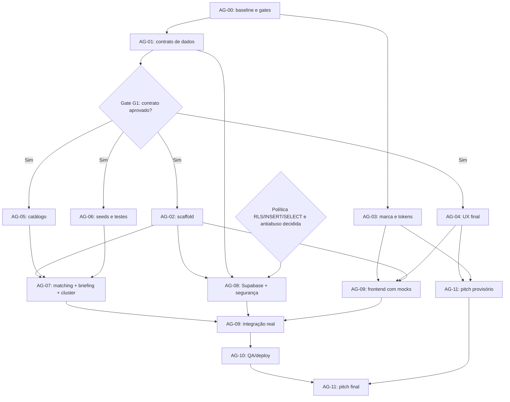

# DEMANDA VIVA — TASKS / PLANO DE EXECUÇÃO

## CHECKPOINT PMO 1.3.0 — validação local e sincronização Git/Drive — 14/11/2026

**Evidência**: capturas apresentadas pelo responsável mostram `npm run check`: ESLint sem erros, **36/36 testes em 6 arquivos**, build `tsc -b && vite build` concluído, `verify-spa-build: OK` (index.html, ausência de 404.html e de segredos detectados). `git status`: main sincronizada com origin/main, com apenas `.cursor/` e `.wrangler/` não rastreados. Não foi executado CI independente pelo PMO.

**Git:** [commit 31481ad](https://github.com/carloseesantos/DemandaViva-Hackaton7.0/commit/31481ad9b1e25b44e0b03b225a4794c3ea1d416a) publica AG-04/AG-05 e correções de setup (.env.example, .gitignore, .node-version). **ZIP:** [DemandaViva-Hackaton7.0-main.zip](https://drive.google.com/file/d/1OslrqHYazOEYfNrpl_o42f6HUvud5UMI/view), atualizado em 14/11; Git blob SHA de cinco caminhos críticos coincide com o ZIP. O ZIP não inclui `src/data/seed-demands.ts` nem `src/data/registries.ts` (AG-06 a produzir/alinhar).

| Frente | Estado pós-verificação | Gate/ação |
|---|---|---|
| **AG-02** | **ACEITO documental/tecnicamente para scaffold**: repo, arquivos de configuração, tipo AG-01, DI, rotas e ferramentas versionados; testes relatados pelo executor e commit validado pelo PMO. | Entrega de arquitetura/scaffold concluída; não equivale a release. |
| **AG-04** | **ACEITO para integração UX**: `docs/UX_FLOW.md`, `docs/ux/UX_FLOW.mmd`, `docs/ux/HANDOFF_AG04.md` versionados; oito templates, 22 questões, fluxos A/B/C e estados de erro. | Libera **AG-09** para UI com mocks tipados (sem motor/remote real). Validação com usuários e QA de navegação são futuros. |
| **AG-05** | **ACEITO para consumo pelo AG-06/07**: 4 startups, 5 soluções, evidências sintéticas e curadoria em `src/data`; docs e cinco testes em `tests/catalog.test.ts`. | Libera **AG-06** para fixtures finais; os cinco testes usam *referenceMatcher* e **não homologam o motor AG-07**. Cardinalidade 4/5 está na faixa do Doc 07, como demonstração, não catálogo oficial. |
| **AG-06** | **LIBERADO AGORA para executar fixtures finais** com AG-01 + AG-05. | Criar 4 seeds B sem ERP/2 ACs com IDs estáveis, casos A e C separados, contraprovas D/E, registries quando necessários e testes; handoff para AG-07. |
| **AG-09** | **LIBERADO AGORA para UI/fluxos com mocks tipados** segundo AG-04 e tokens Ponte Viva. | Não modificar tipos AG-01, dados AG-05 ou motor AG-07; integrar componentes/rotas; não alegar Supabase funcionando. |
| **AG-08** | **LIBERADO para parecer técnico e código local seguro** (scaffold existente). | Gate **G1S ainda PENDENTE**: política explícita de INSERT/SELECT, RLS/GRANTs, validação e antiabuso antes de deploy/escrita remota. |
| **AG-07** | **BLOQUEADO até handoff de AG-06**. | Após seeds e registries consistentes, motor determinístico, seis gates antes de score, briefing, cluster e testes reais A–E. |
| **AG-10/AG-11** | AG-10 aguarda integração; AG-11 pode continuar pitch provisório. | Não alegar URL Cloudflare nem dados remotos enquanto não testados. |

**Gates vigentes:** G1 = aprovado; **G2 = PARCIAL** (AG-02/03/04/05 fechados para integração, AG-06 pendente); **G1S = ABERTO/crítico**; G3–G6 ainda não concluídos. **Nenhuma US de integração fim a fim foi homologada.** Os checkpoints anteriores abaixo são registros históricos que não substituem este 1.3.0.

**Orientação Git:** `.wrangler/` é estado/cache local de ferramenta: excluir do versionamento; `.cursor/` deve ser revisto para decidir se contém regras de equipe compartilháveis ou apenas preferências locais, e não ser adicionado por engano. A presença dos dois como *untracked* não compromete o `npm run check`, mas pede decisão de hygiene.

## CHECKPOINT PMO 1.2.0 — Rodada 2: Git e entregas AG-02/04/05 (14/11/2026)

**Snapshot auditado:** [GitHub main no commit ee7b426](https://github.com/carloseesantos/DemandaViva-Hackaton7.0/commit/ee7b426e816c8827755328587721ec21b7272f04), pasta [AG-02 / ZIP e Handoffs](https://drive.google.com/drive/folders/11CWoPsdT2MmPBx_zA2qN4SRabXdcpYB0). A equipe informou execução de AG-04 e AG-05 em chats, **porém seus arquivos finais ainda não aparecem na árvore de main auditada**. A execução declarada não é evidência suficiente para concluir handoff e gate.

| Frente | Evidência encontrada | Estado do gate PMO | Ação objetiva |
|---|---|---|---|
| AG-02 | Scaffold React 19/TS/Vite 8, package.json, ARCHITECTURE.md, src/domain/types.ts, roteador, DI, 7 testes arquivos, guardas, logos e tokens versionados no commit `ee7b426`; handoff declara `npm run check` aprovado com **31 testes** e seis rotas de Pages locais retornando 200. | **Entregue/versionado e auditado documentalmente; aceite G2-02 CONDICIONAL**. Verificação independente de npm CI não concluída (runtime auditado Node 22.16 < 22.22 requerido, dependências não estão no cache offline). | Corrigir arquivos **`.env.example`, `.gitignore`, `.node-version` ausentes da árvore Git/ZIP**, apesar de citados no handoff e README. Reexecutar `npm ci && npm run check` em Node compatível, com log/commit; não alegar deploy público. |
| AG-04 | Execução informada pelo responsável; `docs/UX_FLOW.md` e documentação UX ausentes da árvore Git main auditada. | **Pendente de publicação e validação**; não homologar UX nem liberar AG-09 pelo AG-04. | Versionar `docs/UX_FLOW.md`, auxiliares em `docs/ux/`, handoff; confrontar 7–8 telas, A/B/C, contrato e Ponte Viva. |
| AG-05 | Execução informada pelo responsável; `src/data/startups.ts`, `solutions.ts`, `evidences.ts` e matriz AG-05 ausentes da árvore Git main auditada. | **Pendente de publicação e validação**; AG-06 não recebe fixtures finais ainda. | Versionar catálogo em `src/data/` e matriz/handoff em `docs/catalog/`; checar ERP X, curação/validade e B inelegível. |
| AG-06 | AG-01 aprovado; AG-05 sem evidência versionada. | **Planejamento liberado, fixtures finais bloqueadas por AG-05.** | Preparar critérios A–E e seeds B (4, 2 ACs, sem ERP), sem consolidar import incompatível. |
| AG-08 | Infra de placeholder do AG-02 existente; G1S não decidido. | **Análise de segurança liberada; migração/INSERT/SELECT público bloqueados por G1S.** | Propor RLS/GRANTs, proteção efetiva antiabuso e projeção cross-browser restrita para deliberação. |
| AG-09 | Scaffold no Git; UX e catálogo finais não versionados. | **Aguardar handoff AG-04; depois UI com mocks tipados**, respeitando agentes e DI do AG-02. | Assim que AG-04 entrar no main e for validado, implementar páginas; não alterar motor/SQL. |
| AG-07 / AG-10 / AG-11 | AG-07 ainda depende das seeds AG-06; AG-10 depende de integrações; AG-11 pode continuar pitch provisório. | **G3/G4/G5/G6 não liberados.** | Manter ordem: AG-05 → AG-06 → AG-07; AG-08 após G1S; AG-09 após UX; AG-10 após serviços e integração. |

**Status gates:** G1 aprovado anteriormente; **G2 PARCIAL**, pois AG-02 versionado mas correções de packaging/execução independente pendentes e AG-04/05/06 não aceitos no repositório; **G1S ABERTO**, G3–G6 não evidenciados. Em caso de conflito, este checkpoint 1.2.0 prevalece sobre estados históricos 1.0/1.1 abaixo. Não houve nova decisão de arquitetura ou peso do matching.

> **Planejamento 1.2.0 — 14/11/2026** | **PMO:** AG-00 | **Marco atual:** documentação de execução; sem comprovação de desenvolvimento/deploy.
> **Status permitido:** `Proposto` · `Liberado` · `Em andamento` (com evidência) · `Bloqueado` · `Concluído` (com evidência). As ações são instruções futuras, não execuções presumidas.

## CHECKPOINT PMO 1.1.0 — Rodada 1 concluída e G1 aprovado

**Evidências:** [AG-01 DATA_MODEL.md](https://drive.google.com/file/d/1vNF2QbKs30x9aNeGqGpCz-txru4OxnaQ/view) contém tipos, DDL proposto, A/B/C, merge/versionamento e handoff; [AG-03 BRAND_SYSTEM.md](https://drive.google.com/file/d/1TYfIBbUIDPgJfAGFDYDKuGduzYxSJJaJ/view), [HANDOFF](https://drive.google.com/file/d/10Ar1BVEdCDb4tBQIuTG3iWQMTnDH6ZEJ/view), CSS/JSON/SVG e auditoria de 18 pares existem no Drive. Aprovação da equipe recebida em 14/11/2026: modelo G1 aprovado e direção 01 Ponte Viva selecionada. A entrega de especificação não comprova aplicação de SQL, execução de testes da SPA ou deploy.

| Agente | Status atualizado | Próxima execução / observação |
|---|---|---|
| **AG-01** | **Concluído documentalmente / G1 aprovado.** | Congelar DATA_MODEL.md v1.0.0; alterações somente via mudança controlada PMO. DDL não migrado. |
| **AG-03** | **Concluído documentalmente / direção 01 aprovada.** | Fornecer tokens.css/tokens.json, SVGs, UI_COMPONENT_GUIDE e CONTRAST_AUDIT aos consumidores; revisão responsiva real é AG-09/10. |
| **AG-02** | **LIBERADO PARA INICIAR**, condicionado a confirmar workspace/repo. | Espelhar documentos aprovados em docs/, preparar scaffold React/TS/Vite, scripts e ARCHITECTURE.md, executar build/lint/test e reportar evidências. |
| **AG-04** | **LIBERADO PARA INICIAR UX FINAL.** | Usar AG-01 aprovado e identidade Ponte Viva; entregar UX_FLOW.md, jornadas A/B/C, AC/startup, microcopy e estados remotos/erro. |
| **AG-05** | **LIBERADO PARA INICIAR CATÁLOGO.** | Criar startups/soluções fictícias tipadas, preservar B sem ERP inelegível, evidências simuladas; documentar cardinalidade escolhida no intervalo do Doc 07 para ratificação da equipe. |
| **AG-06** | **LIBERADO para planejamento, NÃO para fixtures finais antes de AG-05.** | Preparar matriz A–E, 4 seeds sem ERP/2 ACs; congelar códigos/JSON só após catálogo AG-05. |
| **AG-08** | **LIBERADO para parecer G1S; endpoint público BLOQUEADO.** | Validar Auth Anonymous, projeção restrita, RLS/GRANTs e mitigação efetiva antiabuso; obter decisão da equipe antes da escrita/leitura pública. Implementação depende scaffold. |
| **AG-11** | **LIBERADO para pitch provisório.** | Usar marca Ponte Viva; não inventar métricas/URL nem chamar simulação de homologação. Versão final após AG-10. |
| **AG-07, AG-09, AG-10** | **AGUARDAM GATES seguintes.** | AG-07 após AG-02/05/06; AG-09 pode começar UI com mocks tipados após AG-02/04; AG-10 após integração e testes. |

**Gates atuais:** G0 arquivos PMO publicados, aceite formal geral ainda não registrado; **G1 APROVADO**; **G1S PENDENTE CRÍTICO**; G2/G3/G4/G5/G6 não comprovados. A tabela original abaixo é histórico da baseline 1.0.0, e estados 'bloqueado por G1' ali devem ser lidos à luz deste checkpoint. Os gatilhos restantes e restrições técnicas continuam vigentes.

**Ordem prática:** Rodada 2 simultânea AG-02 + AG-04 + AG-05, AG-06 apenas preparação até conclusão AG-05; AG-08 pode tratar G1S em paralelo. Depois AG-06 final e AG-07/08 implementação; AG-09 inicia com AG-02/04 e integra serviços depois; AG-10 valida/publica e AG-11 congela pitch. Nenhuma dependência é considerada concluída somente por um prompt ter sido disparado.

## 1. Caminho crítico e ordem recomendada

**Não confundir paralelo com pré-requisito cumprido.** O scaffold AG-02 não começa sem contrato aprovado; as fixtures AG-05/06 não usam tipos inventados; o motor AG-07 não começa sem fixtures coerentes e arquitetura; AG-08 não abre INSERT público com RLS indefinida; AG-09 pode desenvolver telas com **mocks tipados** após receber seus próprios requisitos, mas não anunciar integração Supabase/motor até testar de ponta a ponta.

## 2. Gates de entrega

| Gate | Condição objetiva de liberação | Responsável pela evidência | Situação inicial |
| --- | --- | --- | --- |
| **G0 — Baseline** | `PROJECT_CONTEXT`, `AGENTS`, `BACKLOG`, `TASKS`, `DECISIONS`, handoff/riscos publicados; fontes e conflitos rastreados | AG-00 | Publicação desses arquivos depende de verificação final no Drive; **revisão da equipe ainda pendente** |
| **G1 — Contrato de dados** | `DATA_MODEL.md` + tipos/códigos/serialização/DDL propostos + A/B/C + merge e schema versionado, com **aprovação explícita** | AG-01 + equipe | **Bloqueado / não evidenciado** |
| **G1S — Segurança de dados** | Decidir Auth Anonymous/Turnstile ou opção com mitigação equivalente, SELECT de demos, limites de inserção e regras de escrita; registrar riscos residuais | Equipe + AG-08/01 | **Pendente / bloqueia INSERT público** |
| **G2 — Base paralela** | Scaffold compila; marca/tokens; UX definitiva; catálogo e seeds coerentes com AG-01 | AG-02/03/04/05/06 | **Aguardando G1** (AG-03 livre) |
| **G3 — Serviços** | Testes automáticos de gates/90 B sem score/C/cluster + migration/RLS + smoke remoto autorizado | AG-07/08 | **Aguardando G2 e G1S** |
| **G4 — Integração** | UX navega A/B/C, AC/startup, persistência entre sessões e estados offline/erro | AG-09 | **Aguardando G2/G3** |
| **G5 — Release QA** | Matriz de testes preenchida, riscos críticos resolvidos ou explicitamente vetados, build/deep-link/mobile/secrets verificados | AG-10 + PMO | **Não iniciado** |
| **G6 — Banca** | URL Pages realmente acessível e testada, roteiro fiel ao release, contingência pronta | AG-10/11 + equipe | **Não iniciado** |

## 3. Work packages por agente

### AG-00 — PMO / governança (R0)

- **T00-01** Revisar 00–07, sintetizar o escopo atual e identificar que ADR-002 corrige **somente** persistência (saída `PROJECT_CONTEXT.md`).
- **T00-02** Publicar matriz de papéis, donos de arquivo, limites e fontes (`AGENTS.md`).
- **T00-03** Definir US P0/P1 e dependências, sem declarar desenvolvimento pronto (`BACKLOG.md`).
- **T00-04** Definir execução por gates, registro de decisões e riscos (`TASKS.md`, `DECISIONS.md`, `HANDOFF_AND_RISKS.md`).
- **T00-05** Solicitar handoffs, registrar aprovações e liberar rodadas somente diante de evidências; acompanhar riscos diariamente/durante sprint.
- **Evidência de aceite:** links verificados no Drive e checklist de conteúdo, seguido de aprovação de baseline pela equipe. **Situação:** documentação preparada nesta execução; aceite colegiado não presumido.

### AG-01 — Contratos e schema (R1; liberado)

- **T01-01** Derivar `Need`, `Requirement`, `Association`, `Startup`, `Solution`, `CatalogEvidence`, `MatchResult`, `Brief`, `DemandCluster`, `InnovationCall`, `StartupResponse` e `DemandRepository` de 01/02/03/ADR-002.
- **T01-02** Estabelecer tabela campo/tipo/obrigatoriedade/validação, enums e status discriminados para A/B/C; separar fixture estática, estado local, ficha confirmada remota e simulação de UI.
- **T01-03** Descrever `public.demo_demands` com SQL **proposto**: UUID, `created_at`, `owner_id` se Auth Anonymous, códigos controlados, texto curto, JSONB limitado, limites/CHECKs, `is_demo=true` e índice mínimo; sem executar banco.
- **T01-04** Definir serialização TS↔SQL, IDs estáveis, política de dedupe/merge seed+remoto, cluster key derivada, migração/versionamento, compatibilidade entre dados locais e remotos.
- **T01-05** Gerar exemplos JSON **coerentes** A/B/C e decidir/propor persistir ficha final versus diálogo (preferência ADR-002: ficha final; decisão colegiada pendente).
- **T01-06** Handoff com decisões necessárias para equipes: credenciais públicas, RLS/SELECT, Auth Anonymous/antiabuso, funções de contrato e matriz de propriedade.
- **Aceite:** contrato sem tipos ambíguos, cobertura P0, fonte/alternativas/diferenças rastreadas; **aprovação humana registrada** para G1. Arquivos/caminhos sugeridos: `docs/DATA_MODEL.md` + snippets completos de TS/SQL.

### AG-03 — Identidade de marca (R1; liberado, paralelo)

- **T03-01** Manter DEMANDA VIVA (nome aprovado) e DEMANDA dominante; apresentar 2–3 direções tipográficas, paletas HEX e recomendação **não automaticamente aprovada**.
- **T03-02** Produzir `docs/BRAND_SYSTEM.md`, tokens CSS/JSON, especificação de logo, aplicação mobile/desktop, card/CTA/status, contraste e acessibilidade.
- **T03-03** Preparar handoff visual e checklist de assets para AG-09/11; não usar logomarca FACESP sem autorização.
- **Aceite:** tokens reproduzíveis, aplicação e rationale documentados; decisões finais de identidade dependem da equipe.

### AG-02 — Scaffold técnico (R2; bloqueado por G1 e repo)

- **T02-01** Confirmar workspace correto; inspecionar `docs/`, `package.json`, `src/` e `git status`; identificar se há repositório existente.
- **T02-02** Criar React + TS + Vite, roteamento, lint/test/build, estrutura modular e README; configurar `npm run build` → `dist`, roteamento compatível com Cloudflare Pages.
- **T02-03** Preparar `.env.example` **somente** com URL e publishable key, portas de repositório tipadas e configurações sem credenciais; placeholders, não domínio de AG-07 ou banco de AG-08.
- **T02-04** Publicar `docs/ARCHITECTURE.md` com fronteiras e diferenciação das visões C4 conceituais antigas.
- **Aceite:** comandos reais e resultados de lint/build/test, inicialização e refresh de rota; handoff com paths modificados.

### AG-04 — UX, perguntas e estados (R2 para versão final)

- **T04-01** Antes do contrato, produzir apenas roteiro conceitual 7–8 telas e mapa de jornada A/B/C com pendências identificadas.
- **T04-02** Depois do G1, fechar sequência de perguntas, campos exatos, validações, estados `insufficient_data`, resultados com motivos, autorização e fluxo de AC/startup.
- **T04-03** Especificar loading/saving/saved/failed/retry/offline e avisos de simulação; navegação mobile/teclado; storyboard 2–3 minutos.
- **T04-04** Publicar `docs/UX_FLOW.md` + roteiro e aceite por tela; entregar handoff para AG-09/11.
- **Aceite:** nenhuma cópia sugere aprovação real ou IA generativa em tempo real; campos iguais ao DATA_MODEL.

### AG-05 — Catálogo fictício (R2; bloqueado por G1)

- **T05-01** Criar **3–5 startups fictícias e 4–6 soluções fictícias** conforme plano 07, em estrutura de dados aprovada (a meta mínima da ADR-001 era menor; divergência documentada em `DECISIONS.md`).
- **T05-02** Incluir EstoquePonte/ERP X, solução parcialmente condicional e registro não validado/expirado; requisitos explícitos e evidências sempre simuladas.
- **T05-03** Entregar `src/data/startups.ts`, `solutions.ts` ou JSON, matriz gate↔requisito e pelo menos 5 casos de elegibilidade.
- **Aceite:** B segue inelegível no catálogo criado; código/fichas não inventam validação comercial.

### AG-06 — Seeds e contraprovas (R2; bloqueado por G1/05)

- **T06-01** Criar quatro demandas sintéticas de **AC Alfa e AC Beta** com variantes sem ERP para o cluster de confirmação de estoque/WhatsApp; não confundir com caso A separado, que usa ERP X.
- **T06-02** Especificar cenários teste: A 90/100, B bloqueado sem score, C incompleto, D mesmo texto mas restrições/processo incompatíveis, E teto rígido inviável.
- **T06-03** Entregar `src/data/seed-demands.ts` e roteiro de nova demanda remota (quinta lógica), IDs estáveis e expectativa de contagem adaptativa.
- **Aceite:** dados sintéticos, coerentes com catálogo e AG-01; handoff para AG-07/09/10.

### AG-07 — Domínio determinístico (R3; bloqueado por G2)

- **T07-01** Implementar validação de necessidade e saída C; avaliar gates em ordem antes de score e registrar razões.
- **T07-02** Implementar score ponderado 30/20/20/15/15 e faixas PROPOSTAS; produzir breakdown/explicação e confiança separadas.
- **T07-03** Implementar briefing de B, heurística de similaridade com problema/processo/restrições/objetivo, cluster apenas sugerido à AC.
- **T07-04** Testes A=90 calculado; B sem ERP sem score; C; catálogo expirado; custo desconhecido; falso cluster; independência de ordem das fixtures.
- **Aceite:** funções puras, testes executados e logs de comando; `src/domain/`, `src/services/` e handoff.

### AG-08 — Persistência / RLS / proteção (R3; bloqueado G1/G1S/G2)

- **T08-01** Propor migração com constraints, RLS/GRANTs e sanitização, mapa de autorização por operação; submeter decisão de INSERT/SELECT e antispam sem relaxar segurança.
- **T08-02** Implementar `DemandRepository`, adaptadores Supabase/seeds/composite e `.env.example` seguro usando tipos do AG-01.
- **T08-03** Se houver autorização e ambiente, aplicar migração e **testar** INSERT qualificado, SELECT em outra sessão e negações de operações; registrar IDs sintéticos e comandos sem segredos.
- **T08-04** Documentar fallback e limites do free tier; guardar somente demanda final e não rascunhos do diálogo.
- **Aceite:** matriz de políticas validada e status remoto real. Se sem credenciais/segurança, entregar código e documento como **não implantado**.

### AG-09 — Frontend e integração (R3/R4)

- **T09-01** Com AG-02/03/04, montar páginas responsivas e componentes; mocks **tipados** e claramente temporários para serviços não concluídos.
- **T09-02** Integrar AG-07 sem alterar regra de domínio; A/B/C e narrativa detalhada, cards/briefing/cluster/AC/startup/FACESP.
- **T09-03** Integrar AG-08: estados remotos de verdade, dedupe, contador dinâmico, refresh, falha/retry, aviso de perfil simulado e reset apenas local.
- **T09-04** Entregar testes de componentes/fluxos, screenshots e README, comandos efetivamente executados; handoff para QA.
- **Aceite:** telas cobrem US-01–14 sem falsear sincronização ou decisões de papéis.

### AG-10 — Integração, QA, release (R4; bloqueado por 07/08/09)

- **T10-01** Executar lint/build/test e testes fim a fim A/B/C, gates/custo/curadoria, cluster, duas ACs, novo registro entre navegadores, erro de rede, deep links, mobile, teclado e ausência de PII/secrets.
- **T10-02** Verificar RLS/grants negativas; vetar deploy com risco alto de exposição ou INSERT público inseguro.
- **T10-03** Escrever `docs/QA_REPORT.md` com casos, resultados, evidências e defeitos; publicar em Cloudflare Pages **se houver autorização e acesso**, checar HTTPS/URL anônima e preparar backup.
- **T10-04** Registrar versão/tag ou commit sem alegar criação do que não executou; handoff real para AG-11/00.
- **Aceite:** provas objetivas; se Cloudflare inacessível, status **deploy não realizado**.

### AG-11 — Pitch e banca (provisório R1/R2, final R4)

- **T11-01** Preparar narrativa provisória de 3 min (5 min opcional) e arquitetura de 6–8 slides, perguntas da banca e plano B; distinguir demonstração da execução real.
- **T11-02** Após QA, substituir placeholders por cliques/prints e URL comprovados; enfatizar cenário A, B, benefício da rede e Supabase somente se de fato testado.
- **T11-03** Entregar fala final, roteiro de ensaio e limitações honestas; sem logotipos FACESP não autorizados e sem métricas de tração reais inexistentes.
- **Aceite:** roteiro reproduzível na versão homologada por AG-10.

## 4. Bloqueios e ações de desbloqueio

| Bloqueio | Impacto | Ação necessária | Quem resolve | Quem pode trabalhar enquanto isso |
| --- | --- | --- | --- | --- |
| **B-01 — contrato AG-01 inexistente ou não aprovado** | G1 e implementação final de 02/04/05/06/07/08/09 | AG-01 entrega contrato; equipe aprova; AG-00 registra versão e link | AG-01 + equipe | AG-03; AG-04/11 conceituais |
| **B-02 — política Supabase pública sem deliberação** | INSERT/SELECT remotos, RLS e risco de abuso | Deliberar Auth Anonymous/Turnstile ou solução efetiva, projeção SELECT e limites | Equipe + AG-08 | AG-01, AG-03, UX conceitual |
| **B-03 — repositório de código/ambiente não confirmado** | Scaffold, testes e deploy | Informar repo e permissões, espelhar arquivos canônicos em `docs/` | Equipe/AG-02 | ChatGPT docs e fixtures planejadas |
| **B-04 — instância/credenciais Supabase e Cloudflare não verificadas** | Teste remoto e URL | Criar ou disponibilizar projetos de demo; autenticação/autorização sem segredos em prompts | Equipe + AG-08/10 | Motor/UX local depois de G1 |
| **B-05 — aprovação de identidade/campos de comunicação pendentes** | Marca final/pitch/UI | Revisar AG-03/04 e aprovar alternativas visuais/microcopy | Equipe | Desenvolvimento por tokens provisórios marcados |

## 5. Checkpoint PMO e quadro de status inicial

| Frente | Status verificável | Próximo passo |
| --- | --- | --- |
| AG-00 | Baseline produzida; aprovação da equipe não comprovada | Validar publicações, recolher aprovação e manter changelog |
| AG-01 | **Liberado, sem entrega constatada** | Produzir `DATA_MODEL.md` e solicitar G1 |
| AG-03 | **Liberado, sem entrega constatada** | Produzir `BRAND_SYSTEM.md` |
| AG-04 | **Liberado só para blueprint conceitual** | Esboçar, aguardar G1 para campos finais |
| AG-11 | **Liberado só para pitch provisório** | Narrativa condicionada a telas/QA reais |
| AG-02/05/06/07/08/09/10 | **Bloqueados por dependências** | Aguardar gates na ordem descrita |

**Cadência sugerida:** registrar handoff no encerramento de cada execução de agente; AG-00 atualiza quadro, riscos, bloqueios e decisões após cada handoff; revisar gates antes de disparar agentes Cursor e imediatamente antes do pitch. Tempo/calendário real de implementação não é assumido neste plano.