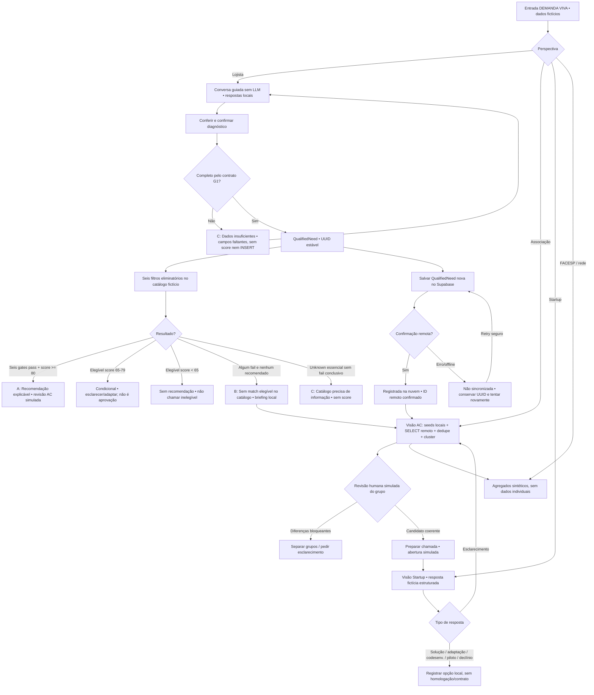

# DEMANDA VIVA — UX_FLOW.md
**AG-04 | UX Research • Service Design • Conversation Design | Versão 1.0 | 14/11/2026**  
**Status:** especificação UX proposta para implementação; respeita G1 aprovado, direção Ponte Viva aprovada. Não representa validação com usuários nem implementação.

## 0. Fontes, precedência e limites

**Consultados efetivamente no Drive:** Docs 00 (marca), 01 (rede decisória), 02 (régua), 03 (briefings), 06/ADR-002 (persistência), `DATA_MODEL.md` AG-01, `PROJECT_CONTEXT.md` e `DECISIONS.md` AG-00, `BRAND_SYSTEM.md` AG-03. O cabeçalho do `DATA_MODEL.md` ainda diz “entregue para revisão”, mas o checkpoint posterior AG-00 1.1.0 registra aprovação explícita G1 — esta é a decisão operacional vigente. Direção visual aprovada: **01 Ponte Viva** (`#11273A`, `#075E6B`, `#25BAA7`, Manrope). G1S de políticas Supabase/antiabuso continua pendente; não tratar como deploy aprovado.

**Escopo funcional fixo:** React + TypeScript + Vite em Cloudflare Pages; catálogo, soluções, quatro seeds e cenários fictícios locais; somente `QualifiedNeed` nova, confirmada e sintética vai ao Supabase. Filtros obrigatórios antes de score; não há LLM em tempo real. `NeedDraft` e respostas intermediárias são locais. Aprovações AC, chamadas, respostas startup e painel FACESP são simulações/projeções, não fluxos operacionais reais. A troca de perspectiva não autentica usuários. Não cria software automaticamente.

**Cautela:** no Doc 02, pesos 30/20/20/15/15 e thresholds 80/65 são **propostas da equipe** e não critérios oficiais FACESP. Catálogo “validado para demonstração” não significa validação real de mercado. Todo dado é sintético e não deve ser confundido com tração real.

### 0.1 Sem lacunas de fontes primárias; fronteira dos campos
O G1 foi localizado e aprovado. Existe uma distinção relevante entre perguntas úteis para descoberta e campos armazenáveis:
- **Persistíveis na `QualifiedNeed` G1:** `associationCode`, `segmentCode`, `sizeCode`, `channelCode`, `painCode`, `processCode`, `frequencyCode`, `hasErp`, `erpCode`, `problemSummary` (template do painCode), `requirements`, `constraints` (`budgetBand`, `dataSharing`, `mobileRequired`, `offlineRequired`, `trainingMaxHours`) e `metric` (`code`, `baseline`, `target`); mais metadados tipados.
- **Apenas ilustrados/localmente efêmeros no P0:** episódio recente em linguagem natural, volume, contorno específico, impacto descritivo, cidade, nome de loja, prazo de projeto, custo de implantação, origem do canal de atendimento, prova real, contato de encaminhamento e aceite jurídico. Não inventar novos campos na tabela nem persistir texto livre ou PII; para gravá-los no futuro é preciso revisão G1 pelo AG-01/AG-00.
- **Autorização para compartilhamento no briefing:** `shareAuthorization: not_requested | simulated_authorized`; não equiparar `constraints.dataSharing` a consentimento jurídico.
- **Cenários:** A (ERP X) é fixture separada, B = quatro seeds sem ERP de duas ACs e eventual quinta demanda remota; C é `NeedDraft` incompleto, não salvo.

## 1. Princípios e hipóteses de UX
1. **Sintoma antes do software:** perguntar “o que aconteceu?” e não “qual sistema você quer comprar?”.
2. **Duas saídas úteis:** A = compatibilidade justificada e demonstração possível; B = demanda transformada em briefing e oportunidade, sem declarar inexistência no mercado.
3. **C é incerteza, não B:** diagnóstico insuficiente ou evidência essencial desconhecida bloqueia recomendação, não produz falso “sem solução”.
4. **Explicação verificável:** mostrar critérios eliminatórios, resultado por critério, evidências e limites; score nunca compensa falha eliminatória.
5. **Human-in-the-loop explícito:** revisão de AC simulada no P0; produto real exigiria autoridade e autenticação.
6. **Operacionalmente honesto:** marcar origem local/remota, estados de sincronização e simulações; nunca inferir sucesso remoto de clique/otimismo.
7. **Sem inventar IA:** entrevista e sínteses têm caminhos, templates, regras e fixtures determinísticas versionadas; “IA em tempo real” não aparece na UI.
8. **Amplitude com fluidez:** caminho rápido pré-preenchido para pitch, mantendo “Ver todas as perguntas” e edição por etapas.

## 2. Personas, jobs-to-be-done e critérios de sucesso
| Perfil | Trabalho a realizar | Evidência de êxito na demonstração |
|---|---|---|
| Lojista fictício | Explicar dor sem jargão, conferir o diagnóstico, entender o próximo passo | Identifica a rotina, orçamento/ERP e entende por que houve A, B ou C |
| Atendente AC (perspectiva simulada) | Comparar necessidades, investigar recorrência, propor oportunidade | Revê 4 seeds + novos registros efetivamente sincronizados, vê variações e prepara chamada local |
| Startup fictícia | Avaliar oportunidade clara e responder com condições | Responde com pedido de esclarecimento, alternativa ou piloto; sem se comprometer automaticamente |
| FACESP/regional (perspectiva demonstrativa) | Entender padrões agregados | Vê totais por AC, tema, canal e status a partir do conjunto sintético visível, sem dados pessoais |

**Sinais testáveis:** diagnósticos A/B/C compreensíveis sem mediação do apresentador, rótulos de simulação visíveis, repetibilidade de mesmos inputs, conclusão do roteiro em 2–3 min, painel cross-browser com contagem real após SELECT e nenhuma alegação de aprovação/deploy/tração não comprovada.

## 3. Service blueprint

| Etapa | Evidência/contato visível (frontstage) | Ação do lojista | Processamento invisível (backstage) | Persistência e origem | Papel humano / exceção |
|---|---|---|---|---|---|
| E0 Entrada | Home, papéis “Visão demonstrativa”, aviso dados fictícios | Seleciona Lojista e caso guiado | Carrega registry, fixtures e tokens; checa disponibilidade remota sem bloquear SPA | Local; nenhum INSERT | AC é referência fictícia, sem login |
| E1 Descoberta | Perguntas curtas, etapa/progresso e resumo lateral | Escolhe AC, segmento, canal, dor, episódio | Mapeia códigos; episódio ilustrativo restrito ao frontend | `NeedDraft` React/localStorage opcional | Se relato não bate com opções, sinaliza limite do protótipo |
| E2 Operação | Processo, frequência, ERP, restrições e preço/teto sintético | Completa escolhas e números da métrica | Validação cruzada `hasErp/erpCode/processCode`; regras sobre enum | Somente rascunho local | Não solicitar CPF, telefone, e-mail, dados reais |
| E3 Confirmação | Diagnóstico factual, obrigatórios/desejáveis, meta | Corrige e confirma ficha demonstrativa | Runtime schema validation; cria UUID estável e `QualifiedNeed` se completo | Antes da confirmação: **não** escrever no Supabase | Dados ausentes geram C; não forçar conclusão |
| E4 Matching | “Comparando com catálogo de demonstração…” | Aguarda/consulta critérios | Executa seis gates; score apenas candidatos com seis `pass`; constrói resultado/brief local | Nenhum match/brief persistido | Limite: catálogo fictício e incompleto |
| E5 Gravação | “Salvando demanda…” → “Registrada na nuvem — ID...” | Pode ver resultado sem aguardar remotamente | `DemandRepository.save`; valida resposta da API; retry com MESMO UUID | Apenas `QualifiedNeed` nova remota; origem `remote` | Falha/offline = não sincronizada; jamais simular sucesso |
| E6A A | Resultado elegível, score explicado, ressalvas | Explora simulação de solicitação de demonstração | Renderiza `MatchEvaluation` tipada, gates e cinco componentes | Sem aprovação ou pedido remoto | “Revisão AC simulada”; escolha não cria contrato |
| E6B B | Reprovação técnica e briefing | Lê, solicita revisão do briefing | `Brief` derivado, gaps de catálogo, similaridade determinística | Brief/cluster locais | AC revisa proposta e eventual chamada simulada |
| E6C C | Campos pendentes e CTA corrigir | Completa diagnóstico | `NeedDraft.missingFields`; não pontuar | Local-only; nenhum INSERT | Não confundir dado faltante com mercado sem solução |
| E7 Rede | Painel AC com registros e agrupamento | AC fictícia revisa diferenças e prepara chamada | `list()` + merge seeds por ID + cluster, contagens verdadeiras | SELECT remoto sujeito a G1S; seeds locais | Aprovação e chamada apenas demonstrativas |
| E8 Resposta | Startup vê briefing minimizado e escolhe resposta | Startup fictícia pede esclarecimento ou propõe possibilidade | Fixture de `StartupResponse`, sem envio real | Local, `demoOnly=true` | Não homologar proposta automaticamente |
| E9 Tendências | FACESP mostra apenas agregados e escopo demonstrativo | Compara filtros | Agrega conjunto sintético disponível; sem PII | Projeção local/SELECT sanitizado (se aprovado) | Nenhum acesso institucional efetivo no P0 |

**Linhas de visibilidade:** a pessoa vê escolhas, explicações, IDs e status; motor, serialização e RLS não são ações institucionais. A linha de persistência separa `QualifiedNeed` confirmada dos demais artefatos locais. A linha de decisão separa proposta/registro em software de aprovação por AC real.

## 4. Fluxograma Mermaid de ponta a ponta

**Nuance G1:** se os seis gates passam mas score <65, o resultado canônico é `no_recommendation` e não `no_eligible_catalog_solution`. Se restarem informações de catálogo desconhecidas sem falha conclusiva, `insufficient_data`. Se uma candidata falha gate, não tem propriedade `score`, nem `score: null`. A UI não transforma `conditional` em “solução aprovada”.

## 5. Mapa de navegação e rotas (proposta AG-04, AG-02 confirma router)

| Rota | Template | Estado/fonte | Observação |
|---|---|---|---|
| `/` | T1 Entrada | local | `?cenario=a|b|c` apenas navegação demonstrativa; não criar registros remotos |
| `/diagnostico` | T2 Conversa guiada | `NeedDraft` local | `?passo=1..5` URL opcional; não persistir dados sensíveis na query |
| `/diagnostico/revisar` | T3 Confirmação | `NeedDraft` local | precisa validação antes de confirmar |
| `/resultado/:id` | T4/T5 Resultado A/B/C | `MatchEvaluation` calculada localmente | Resolver seed/remoto autorizado por `id`; não pressupor sessão com permissão |
| `/associacao/demandas` | T6 Painel AC | seeds + repositório remoto sob G1S | Perspectiva simulada, filtro por AC, botão atualizar |
| `/associacao/chamadas/:clusterId` | T6 detalhe / modal | `DemandCluster` + `InnovationCall` locais | Mostrar “Minuta demonstrativa; não publicada” |
| `/startup/chamadas/:callId` | T7 Resposta startup | fixture/projeção local | Resposta e feedback simulados |
| `/rede/indicadores` | T8 FACESP/regional | agregados sintéticos | Nunca mostrar listagem pessoal ou filtro individual sensível |
| `*` | Not found | local | CTA “Voltar ao início”; aviso demo presente |

`/diagnostico` usa cinco seções e é **um template**, evitando 13 páginas para a banca. A/B/C devem ser rotas ou variantes **distintas por estado**. Rota `:id` exige tratamento de registro inexistente, incompleto, incompatível com `schemaVersion`, sem conexão ou não autorizado. A troca de visão é apenas um seletor de demonstração, não RBAC.

## 6. Storyboard — 8 telas principais

### T1 — Entrada e perspectiva
**Composição:** cabeçalho logo Ponte Viva; selo “DEMONSTRAÇÃO • DADOS FICTÍCIOS”; headline “Sua necessidade pode encontrar um próximo passo”; card principal “Qualificar uma necessidade”; seletor “Ver como: Lojista | Associação | Startup | FACESP/rede (simulação)”; 3 cenários A, B, C em menu do apresentador.  
**CTA:** “Iniciar diagnóstico demonstrativo”; secundário “Explorar a rede”.  
**Aceite:** T1-01 não alega autenticação; T1-02 a seleção altera apenas perspectiva; T1-03 aviso visível em desktop/mobile/zoom; T1-04 não cria demanda remota ao selecionar cenário.

### T2 — Conversa guiada (5 etapas, progressiva)
**Composição:** “Etapa 2 de 5”; uma pergunta principal por vez, resumo do que já foi informado, respostas em rádio/select/chips, acesso “Ver todas as perguntas” e voltar sem perder rascunho. A linguagem deve ser acessível a quem não domina ERP/integração.  
**Etapas:** 1 Contexto; 2 Problema e episódio; 3 Rotina e ferramentas; 4 Limites e requisitos; 5 Meta e revisão preliminar. Os textos exatos estão na seção 7.  
**Aceite:** T2-01 não permite campos fora do vocabulário G1 serem enviados; T2-02 `hasErp=false` limpa `erpCode`; T2-03 campos não respondidos ficam realmente ausentes (não defaults silenciosos); T2-04 preview não aciona LLM; T2-05 C pode ser atingido com campo crítico pendente; T2-06 rascunho é local e assim sinalizado.

### T3 — Resumo e confirmação
**Composição:** resumo em quatro blocos “O que acontece / Como funciona hoje / Limites inegociáveis / Como mediremos”; legenda “Declarações do cenário fictício; não verificadas no mercado”; botões “Corrigir” e “Confirmar diagnóstico e comparar”. Informações ilustrativas efêmeras (episódio, impacto) rotuladas “contexto desta simulação — não será enviado”.  
**Aceite:** T3-01 confirmação é explícita; T3-02 validadores retornam C com `missingFields` antes de salvar; T3-03 criam o mesmo UUID para todos os retries; T3-04 somente `QualifiedNeed` canônica é serializada; T3-05 evento de confirmação não implica aprovação AC.

### T4 — Resultado A: solução elegível
**Composição:** “Solução elegível no catálogo de demonstração”; solução fictícia `EstoquePonte` com `90/100` **calculado** se o fixture A der esse resultado; lista de seis filtros aprovados; breakdown 30/20/20/15/15, notas 5,5,4,4,4; “Por que se encaixa”, “O que precisa ser confirmado”, “Evidências simuladas”, “Custo declarado/não informado”, “Revisão da Associação (simulada)”.  
**CTA:** “Simular pedido de demonstração”; “Ver como calculamos”.  
**Aceite:** T4-01 só renderiza score em `eligible`; T4-02 score igual ao motor, não texto fixo; T4-03 `conditional` fica com “Requer esclarecimentos” e sem aprovação; T4-04 evidências/cura do catálogo rotuladas simuladas; T4-05 inclui disclaimer dos pesos e thresholds não oficiais.

### T5 — Resultado B / subestado C (conteúdos e tratamentos diferentes)
**B:** título “Nenhuma solução elegível no catálogo consultado”; subtítulo “A solução examinada exige ERP X; esta loja opera sem ERP”; ficha “Briefing técnico preparado”; quadro de filtros reprovados por solução (sem nota/score); próximos passos “Revisar briefing” e “Ver demandas semelhantes na Associação”. Texto de alcance: “Isto não significa que não existam outras soluções no mercado”.  
**C:** título “Ainda faltam informações para verificar compatibilidade”; lista de pendências concretas, sem briefing conclusivo, sem score, sem confirmação remota para `NeedDraft`; CTA “Completar diagnóstico”. Se C vier de informação crítica desconhecida no catálogo após ficha qualificada, explicar o bloqueio “Precisamos de dados do catálogo”, e não pedir ao lojista dado que só a startup conhece.  
**Aceite:** T5-01 B só quando saída `no_eligible_catalog_solution`; T5-02 nenhum candidato `ineligible` exibe score; T5-03 `no_recommendation` tem mensagem própria e não é transformado em B; T5-04 C é legível e recuperável; T5-05 briefing é uma minuta local; T5-06 existe banner de origem/sincronização separado da classificação.

### T6 — Associação Comercial: demandas e oportunidades
**Composição:** selo “Visão simulada da Associação Comercial — não representa acesso institucional”; KPIs contagem total visível, registros seed, registros remotos efetivamente lidos, ACs distintas, clusters candidatos; filtro AC Alfa/Beta; lista com tags “Seed local / Sincronizada” e status; agrupamento por problema/processo/contexto ERP/canal/métrica; quadro de **variações e conflitos**; ação “Revisar agrupamento (simulação)” e “Preparar chamada (simulação)”. Um agrupamento não é uma aprovação.  
**Aceite:** T6-01 `merge` deduplica por ID; T6-02 4→5 apenas se SELECT de fato retornou uma quinta relevante e não havia outras; T6-03 botão “Atualizar demandas” dispara leitura verdadeira quando G1S autorizado; T6-04 a lista não mostra dados reais/PII; T6-05 conflitos bloqueantes impedem “aprovar automaticamente”; T6-06 chamada nunca aparece como publicada/real.

### T7 — Startup: resposta à chamada
**Composição:** selo “Resposta fictícia — não enviada”; título da oportunidade baseado no problema, não no nome de produto; requisitos mínimos, contextos sem ERP, métricas, variações, perguntas em aberto; selector “Pedir esclarecimento / Informar solução existente / Propor adaptação / Codesenvolvimento / Piloto / Declinar”; campos apresentados via templates pré-escritos, sem preços ou prazos inventados.  
**Aceite:** T7-01 seis opções mapeiam a `ResponseType` canônica; T7-02 perguntas/dependências/risco são visíveis; T7-03 resposta é local e rotulada demo; T7-04 não altera catálogo/validação nem cria contrato; T7-05 custos desconhecidos exibem “Não informado”, não R$0.

### T8 — FACESP/regional: agregados (modo demonstração)
**Composição:** selo “Visão agregada demonstrativa — dados fictícios, não estatísticas de associados”; total de fichas qualificadas visíveis, distribuição por `associationCode`, `painCode`, `channelCode`, `origin`, andamento das chamadas simuladas; nota “Acesso institucional real exigiria autenticação e políticas de compartilhamento”.  
**Aceite:** T8-01 nenhum dado individual sensível/identificável; T8-02 origem seed/remoto e denominador explícitos; T8-03 nenhuma métrica é apresentada como levantamento real FACESP; T8-04 comportamento em ausência de Supabase usa apenas seeds com aviso; T8-05 contagens derivadas da fonte visível, não hardcode.

## 7. Roteiro exato da entrevista guiada (sem LLM)

**UI comum:** toda pergunta tem opções tipadas, botão “Voltar”, “Próximo”, “Não sei” SOMENTE quando não colidir com obrigatoriedade e “Ver por que perguntamos”; quando falta dado essencial, manter pendência e gerar C. Exemplos e episódios são ilustrativos, nunca inputs livres enviados ao backend. “Resumo em uma frase” vem de `PAIN_TEMPLATES[painCode]`, não de síntese de IA.

| # | Pergunta **exata** da tela | Controle e mapeamento G1 | Ajuda / regra |
|---:|---|---|---|
| 01 | “Qual Associação Comercial acompanha este atendimento de demonstração?” | Select: AC Alfa=`ac_alfa` / AC Beta=`ac_beta` → `associationCode` | “Associações fictícias.” Obrigatório |
| 02 | “Em que tipo de comércio esta loja se encaixa?” | Chips: Papelaria=`stationery`; Moda=`fashion`; Utilidades=`housewares`; Presentes=`gifts`; Alimentação=`grocery`; Outro=`other` → `segmentCode` | `other` não abre livre texto |
| 03 | “Qual o porte desta loja fictícia?” | Rádio: Microempresa=`micro`; Pequena empresa=`small` → `sizeCode` | Sem faturamento ou CNPJ |
| 04 | “Por qual canal a situação acontece principalmente?” | Rádio: WhatsApp=`whatsapp`; Balcão=`counter`; Loja virtual=`ecommerce`; Vários canais=`mixed` → `channelCode` | Canal principal |
| 05 | “Qual situação está dificultando a rotina da loja?” | Cards: “Demora para confirmar estoque”=`stock_confirmation_delay`; “Dificuldade em conferir vendas”=`sales_reconciliation`; “Perda de acompanhamento de clientes”=`customer_follow_up` → `painCode` | Não pedir nome de software |
| 06 | “No exemplo desta simulação, o que aconteceu da última vez?” | Escolha de **episódio fictício** por `painCode`: “Cliente pediu produto e a equipe precisou conferir manualmente”; “Vendas e registros não coincidiram”; “Um cliente ficou sem retorno” | **Ephemeral UI**, não entra `QualifiedNeed`; legenda “Exemplo fictício para contextualizar” |
| 07 | “Como a equipe tenta resolver isso hoje?” | Rádio: Conferência visual=`visual_check`; Planilha=`spreadsheet_check`; Mensagens manuais=`manual_message`; Consulta ao ERP=`erp_lookup`; Outro processo=`other` → `processCode` | `erp_lookup` exige `hasErp=true` |
| 08 | “Com que frequência isso acontece neste cenário?” | Rádio: Todo dia=`daily`; Toda semana=`weekly`; Todo mês=`monthly` → `frequencyCode` | Sem contagens não tipadas |
| 09 | “Qual é o principal impacto neste exemplo?” | Cards ilustrativos locais: “Demora no atendimento”; “Retrabalho”; “Risco de perder venda” | Ephemeral, sem coluna remota; não alegar medição |
| 10 | “A loja utiliza um ERP para controlar a operação?” | Rádio Sim/Não → `hasErp`; se Sim, perguntar “Qual ERP deste cenário?” opção “ERP X”=`erp_x` | Se Não, `erpCode=null` e bloquear `erp_lookup` |
| 11 | “O que uma solução precisa fazer obrigatoriamente para ajudar?” | Multi-select `RequirementCode` obrigatório: “Consultar estoque”=`stock_lookup`; “Funcionar com pedidos no WhatsApp”=`whatsapp_workflow`; “Atender mais de uma loja”=`multi_store`; “Não exigir ERP”=`no_erp_dependency`; “Ser acessível no celular”=`mobile_access`; “Permitir atualizar estoque manualmente”=`manual_stock_update`; “Restringir dados compartilhados”=`privacy_preserving`; “Ter treinamento curto”=`short_training` | Selecionar 1–8. Critérios de aceite do registry; impedir contraditório com `hasErp` onde relevante |
| 12 | “Quais recursos seriam bons de ter, mas não são indispensáveis?” | Mesma lista não selecionada acima, classificada `optional` e ordenada por prioridade `1|2|3` do registry | Até 8, sem duplicatas; “Nenhum” permitido |
| 13 | “Qual seria o teto mensal de gasto para este cenário fictício?” | Rádio: Até R$200=`low`; até R$500=`medium`; até R$1.000=`high` → `constraints.budgetBand` | Valores hipotéticos fixados no G1; não pedir valor real; custo de implantação não representado no P0 |
| 14 | “Quanto a loja pode compartilhar com uma solução externa?” | Rádio: Nenhum dado=`none`; Apenas o necessário, com restrições=`restricted`; Dados permitidos no cenário=`allowed` → `constraints.dataSharing` | **Não** é consentimento jurídico |
| 15 | “A solução precisa funcionar em celular?” | Switch Sim/Não → `constraints.mobileRequired` | Não converter silêncio em false |
| 16 | “Ela precisa funcionar sem internet?” | Switch Sim/Não → `constraints.offlineRequired` | Sem suposição de estabilidade |
| 17 | “Qual o máximo de horas de treinamento aceitável neste exemplo?” | Select 0..8 horas → `constraints.trainingMaxHours` | Valores inteiros do G1 |
| 18 | “Qual resultado você gostaria de melhorar?” | Rádio: “Minutos para confirmar estoque”=`confirmation_minutes`; “Horas gastas por semana”=`hours_per_week`; “Percentual de erros”=`error_rate_pct` → `metric.code` | Exibir unidade |
| 19 | “Hoje, qual é o valor desse indicador no cenário?” | Campo numérico controlado → `metric.baseline` | 0–10.000, finito; exemplo B = 7 minutos, simulado |
| 20 | “Qual valor seria uma melhora relevante?” | Campo numérico controlado → `metric.target` | `0 <= target < baseline`; exemplo B = 2 minutos, simulado |
| 21 | “Este resumo descreve corretamente a necessidade fictícia?” | Confirmação explícita “Sim, confirmar diagnóstico demonstrativo” / “Não, corrigir” | `problemSummary` = template do `painCode`, não texto livre; gera `QualifiedNeed` apenas se válido |
| 22 | “Você quer ver o resultado da comparação com o catálogo fictício?” | CTA “Comparar soluções” | Sem promessa de solução ou software novo; não adiciona campo ao contrato |

**Perguntas apenas informativas, expandidas em “Ver detalhes” (não persistíveis G1):** “Quantos pedidos foram afetados?”, “Qual o contorno aplicado?”, “Qual prazo desejado para teste?”, “Quem acompanharia um piloto?”, “Qual seria o orçamento de implantação?” e “Você autoriza eventual compartilhamento?” As respostas, se exibidas, são escolhas de cenário fictício e não devem entrar no payload. Consentimento real e prazo exigem governança/modelo futuro. Não ocultar essa limitação.

**Roteiro compacto para banca:** na T2 mostrar as 5 etapas como painéis colapsáveis e usar **“Preencher com cenário fictício B”**; apresentador abre visualmente ERP/limite/requisito/meta e confirma. Isto não dispensa validação runtime nem transforma seed em remoto: novo caso B usa novo UUID e precisa de INSERT real para a prova cross-browser. “Preencher com cenário A” é fixture local e NÃO deve ser gravada como demanda de rede por padrão.

### 7.1 Regras de validação e mensagens por campo

| Regra | Comportamento | Mensagem exata |
|---|---|---|
| AC/segmento/canal/problema ausente | impedir qualificação | “Escolha uma opção para continuar o diagnóstico.” |
| `hasErp=false` e `processCode=erp_lookup` | inconsistência | “Você informou que não usa ERP. Escolha como consulta as informações hoje.” |
| `hasErp=true`, `erpCode=null` | pendente | “Selecione o ERP do cenário ou volte e marque ‘Não’.” |
| Nenhum obrigatório | C | “Marque ao menos um requisito indispensável.” |
| Código repetido em obrigatório/opcional | bloquear duplicata | “Este requisito já foi selecionado em outra categoria.” |
| Orçamento ausente | C, não virar 0 | “Informe um teto mensal fictício para avaliar o custo.” |
| `target >= baseline` | impedir | “A meta precisa ser menor que o valor atual para este indicador.” |
| Métrica vazia / não finita | C | “Informe o indicador, o valor atual e a meta numérica.” |
| Envio de texto livre/PII | não oferecer controle P0 | “Nesta demonstração, utilizamos apenas informações fictícias e opções predefinidas.” |
| Catálogo sem preço/evidência crítica | não inventar match | “Precisamos confirmar informações da solução antes de recomendá-la.” |
| Ocorre erro de esquema/versão | estado de erro | “Este registro usa uma versão de dados incompatível. Não foi incluído na análise.” |

## 8. Resultado A — explicabilidade sem “score mágico”

**Título:** “Uma solução elegível foi encontrada no catálogo de demonstração”.  
**Legenda:** “Compatibilidade estimada pelo método proposto da equipe; não é probabilidade de sucesso e não representa certificação FACESP.”  
**Seis gates visíveis, por nome legível:** (1) resolve função essencial, (2) dependências técnicas disponíveis, (3) cabe no teto rígido, (4) respeita restrições de dados, (5) atende porte/canal/território, (6) curadoria e evidências **simuladas** vigentes. Cada gate: status `pass/fail/unknown` + motivo e evidência (se fixture disponível).  
**Breakdown somente elegíveis:** funcional 30%, técnica 20%, econômica 20%, implantação 15%, evidências 15%. Somar `weight*(rating/5)`, não renderizar pontuação “90” hardcoded. Exemplo A aprovado pelo Doc 02: 5,5,4,4,4 → 90/100.  
**Limites:** apresentar preço apenas se ficha o informar, nunca estimar; documentos e provas são fictícios; AC pode revisar.  
**CTA simulado:** “Solicitar demonstração (simulação)” abre um painel local “Este pedido não será enviado a nenhuma empresa. Em operação real, dependeria de autorização da AC e interesse do lojista.”

## 9. Resultado B — briefing técnico e chamada

**Texto principal:** “Não identificamos uma solução elegível no catálogo consultado, considerando as restrições informadas.”  
**Exemplo B:** “A EstoquePonte exige ERP X; esta loja usa WhatsApp e planilha e não possui ERP. A solução falhou no requisito técnico obrigatório. Não mostramos score porque ela é inelegível.”  
**Complemento obrigatório:** “Isso não significa que não exista outra solução no mercado.”  
**Briefing gerado por template local:** `brief:${needId}:v1`; problema e processo; quem é afetado (perfil sintético); códigos obrigatórios/desejáveis traduzidos via registry; restrições; indicador atual/meta; lacunas de catálogo `catalogGaps`; perguntas à startup `openQuestions`; campo de revisão `mode:'simulated'`, status `draft`; sem dados pessoais.  
**CTA:** “Revisar briefing”; “Explorar demandas semelhantes (simulação)”.  
**AC:** cluster usa igualdade compatível de problema central, família de processo, `erpContext`, canal e métrica; testa restrições divergentes (`blockingConflicts`); não soma por texto parecido apenas. `distinctRecordCount` conta **registros** únicos, não lojistas independentes validados. A aprovação local passa a `reviewed_simulated` e a chamada a `opened_simulated`, jamais `published_real`.  
**Startup:** exemplo ficcional de esclarecimento “Para avaliar uma adaptação, precisamos conhecer a quantidade de itens, a frequência de atualização do estoque e a conectividade das lojas.” Não supor compromisso, valor, prazo ou proposta validada.

## 10. Resultado C — dados insuficientes

**C1: ficha incompleta.** `NeedDraft.status='insufficient_data'` e `missingFields` tipados; não chamar `repository.save`, não pontuar, não declarar “sem solução”; manter rascunho na sessão e oferecer “Voltar à pergunta pendente”.  
**C2: ficha qualificada, catálogo com informações essenciais desconhecidas, sem fail conclusivo.** Persistência da ficha pode ter sucesso, mas matching devolve `insufficient_data`; CTA “Solicitar esclarecimento sobre a solução (simulação)” e explicação de qual dado da curadoria falta. Para roteiro P0, usar C1 como caso obrigatório; C2 pode virar teste de QA.  
**Resultado abaixo do threshold:** `no_recommendation` não é C nem “sem match elegível”; copy “Existem soluções elegíveis no catálogo, mas nenhuma atingiu a faixa proposta de recomendação. A Associação deve revisar os pontos de atenção (simulação).”

## 11. Estados assíncronos e microcopy exata

| Evento/estado | Copy apresentada | Regras e comportamento |
|---|---|---|
| Inicialização catálogo | “Preparando catálogo e exemplos fictícios…” | Estado rápido local, sem spinner eterno |
| Motor executando | “Verificando requisitos obrigatórios antes de calcular compatibilidade…” | Não mostrar resultado parcial como definitivo |
| Campo inválido | “Confira o campo indicado para continuar.” + erro específico | Foco/`aria-describedby`; evitar perda de dados |
| Confirmar `NeedDraft` incompleto | “Ainda faltam informações para concluir o diagnóstico.” | Vai para C, local only |
| Pré-save | “Sua demanda fictícia está pronta para registro.” | Separar conclusão do diagnóstico da persistência |
| `saving` | “Salvando demanda de demonstração…” | Desabilitar repetição do CTA; estado acessível |
| `synced` | “Demanda registrada na nuvem para esta demonstração. ID: {id}.” | **Somente após** resposta Supabase validada; exibir origem remota e data |
| `sync_failed` | “Não foi possível sincronizar. A demanda não está confirmada na nuvem.” | Oferecer “Tentar novamente”, “Continuar apenas nesta sessão” |
| Offline detectado | “Modo offline: novas demandas não serão compartilhadas entre navegadores.” | Catálogo e 4 seeds seguem; não afirmar disponibilidade da rede |
| Retry em andamento | “Tentando sincronizar novamente a mesma demanda…” | Mesmo UUID, idempotência; consultar `get(id)` em respostas ambíguas |
| Retry confirmado | “Sincronização confirmada. ID: {id}.” | Revalidar retorno API, não inferir por HTTP genérico |
| Falha de leitura AC | “Não foi possível atualizar as demandas registradas na nuvem. Mostrando apenas exemplos locais.” | Contadores rotulados “Parcial — somente seeds” |
| Carregando AC | “Atualizando demandas de demonstração…” | `role=status`, não mostrar “5” pré-computado |
| Cluster encontrado | “Encontramos relatos possivelmente semelhantes. A revisão da Associação ainda é necessária (simulação).” | Exibir variações e conflitos |
| Chamada criada | “Minuta de chamada preparada nesta demonstração. Nenhuma chamada foi publicada.” | Apenas estado local |
| Resposta startup | “Resposta fictícia registrada nesta sessão. Nenhuma startup foi contatada.” | Não enviar |
| Permissão G1S ausente | “A sincronização entre navegadores não está habilitada nesta versão. O diagnóstico continua disponível localmente.” | **Não** criar INSERT/SELECT permissivos para contornar |
| Reset demo | “Reiniciar remove apenas o estado local desta demonstração. Registros já sincronizados não serão excluídos.” | Confirmação explícita |

**Transições e integridade:** `PersistenceState` do AG-01 tem `local_draft`, `saving`, `synced{id,savedAt}`, `sync_failed{id,reason,retryAllowed:true}`. “Aguardando sincronização” é rótulo visual de `sync_failed`/offline com rascunho local, **não adicionar novo valor à union**. Uma resposta ambígua pode ter gravado antes da conexão falhar: retry com mesmo UUID, preferencialmente verificar `get` e deduplicar. Antes de `synced`, botão “Ver no painel AC” deve informar que a demanda talvez não apareça na outra sessão.

### 11.1 Sinalizadores persistentes de simulação

- Header: **“DEMONSTRAÇÃO • DADOS FICTÍCIOS”** em todas as perspectivas, inclusive mobile.
- Seletor: “Visão demonstrativa: Lojista / Associação / Startup / FACESP-rede — não é login”.
- Resultado: “Método, pesos e faixas propostos pela equipe. Não são critérios oficiais FACESP”.
- Catálogo: “Soluções, startups e evidências fictícias, para ilustrar o fluxo”.
- AC: “Revisão e abertura de chamadas simuladas — sem autorização institucional real”.
- Startup: “Resposta simulada — nenhuma startup recebeu este briefing”.
- Rede: “Indicadores calculados exclusivamente de registros fictícios desta demonstração”.
- Conclusão B: “Sem solução elegível **no catálogo consultado**, não no mercado inteiro”.
- Offline: “Apenas local; não compartilhado entre navegadores”.

## 12. Responsividade e acessibilidade

**Meta:** WCAG 2.2 AA em implementação, sem declarar conformidade antes do QA AG-10. Usar tokens Ponte Viva: `ink #11273A`, `primary #075E6B`, `accent #25BAA7`, superfícies claras; não usar texto branco pequeno sobre accent. Manrope com fallback. Campos com borda funcional visível e foco `3px` + offset `2px` conforme AG-03.

**Desktop ≥1024 px:** navegação e resumo em colunas 2/1, área de perguntas até 720 px, resumo sticky que não cobre teclado, cards A/B com evidências. **Tablet 768–1023 px:** resumo colapsável, CTAs no fluxo. **Mobile 320–767 px:** uma coluna, barra de progresso textual, respostas com alvos ≥24×24 px (preferível 44×44), botão Próximo visível sem ocultar erro, detalhes em acordeões acessíveis. A tabela do score vira lista sem scroll horizontal obrigatório; nunca depender de tooltip hover.

**Acessibilidade funcional:** rótulos explícitos e sem placeholder como único nome; `<fieldset><legend>` para opções; mensagens de erro com vínculo ao campo; foco direcionado ao primeiro erro ao prosseguir; status remoto em `role=status` com anúncio não interruptivo e falhas críticas em `role=alert`; progresso “Etapa X de 5”; contraste WCAG AA de texto/controles; navegação por teclado e ordem lógica; escape fecha modal devolvendo foco; não depender de cor; `prefers-reduced-motion`; zoom 200% sem overflow essencial; teste com leitor de tela; números e unidade descritos, não somente sinais gráficos.

**Proteção de entrada:** nenhuma coleta de CPF/CNPJ, e-mail, contato, senha, nome real ou relato livre potencialmente identificável. Opções e frases locais sintéticas; validações em runtime nos limites da UI, no INSERT e no retorno do repositório. UI nunca oferece alternar para “dados reais” sem remodelar governança.

## 13. Roteiro da banca — 2m40s (exemplo com checkpoints reais)

| Tempo-alvo | Ação e fala funcional | Evidência a mostrar |
|---|---|---|
| 0:00–0:15 | T1: “Uma dor pode virar indicação ou oportunidade. Esta é uma demonstração com dados fictícios.” | Identidade Ponte Viva e seletor de perspectivas |
| 0:15–0:45 | T2: “A loja recebe pedidos por WhatsApp, consulta planilha, não tem ERP e precisa reduzir 7 para 2 minutos.” Aplicar **Preencher com cenário B** e abrir principais perguntas. | Requisitos obrigatórios, teto fictício e ERP não presente |
| 0:45–1:00 | T3: “O lojista confere o resumo antes de confirmar.” Confirmar nova ficha. | ID estável, `QualifiedNeed`; acionamento do INSERT |
| 1:00–1:20 | T5 B: “A EstoquePonte exige ERP X; ela é inelegível, portanto não mostramos score. A demanda continua útil.” | Gate falhado, briefing e nota de limitação do catálogo |
| 1:20–1:40 | Estado remoto: se `synced`, mostrar ID confirmado. Abrir visão AC em outro navegador/aba e clicar “Atualizar”. | Registro remoto realmente retornado; 4 seeds + N remoto, contagem real |
| 1:40–2:05 | T6: “A Associação compara problemas semelhantes, preserva restrições e prepara uma chamada.” | Cluster, duas ACs, variações e rótulo de chamada simulada |
| 2:05–2:20 | T7: “Startup responde com perguntas ou proposta de adaptação; nada foi enviado nesta demo.” | Resposta fictícia e pendências |
| 2:20–2:35 | T4 A com fixture separada: “Com ERP X, a mesma dor pode resultar em 90/100 calculado, desde que seis gates passem.” | Breakdown e evidências simuladas |
| 2:35–2:40 | T8 rápido: “Rede só vê agregados sintéticos.” | Indicadores sem dados individuais |

**Plano B honesto:** se Supabase falhar ou G1S não estiver liberado, não narrar a etapa 4→5 como executada. Mostrar status “Não sincronizada”, painel parcial com 4 seeds, explicar que o compartilhamento cross-browser está condicionado a proteção/permissão; manter resultados A/B/C e fluxo local. O roteiro de 2m40s é planejamento, não medição do app.

## 14. Critérios gerais de aceite para AG-09/AG-10

- **CA-G01**: toda perspectiva e cada estado tem disclosure demo persistente.
- **CA-G02**: nenhum input não previsto no contrato é enviado ao Supabase; `problemSummary` remoto vem do template estático de `painCode`.
- **CA-G03**: A: seis gates `pass`, score com breakdown e notas do motor; B: reprovação explícita sem score; C: campos faltantes ou evidência desconhecida sem score.
- **CA-G04**: `no_recommendation`, `conditional` e `no_eligible_catalog_solution` têm cópias diferentes, jamais colapsadas.
- **CA-G05**: após confirmação, somente `QualifiedNeed` sintética final é candidata a INSERT; B pode ser salva se qualificada, C1 não.
- **CA-G06**: sucesso “nuvem” apenas após retorno API validado; falha e retry preservam UUID e contagem sem duplicatas.
- **CA-G07**: seeds são locais; novas remotas são lidas em segunda sessão somente sob políticas G1S aprovadas; contador deriva do merge real.
- **CA-G08**: revisão, chamada e resposta são ações locais simuladas, não publicação/aceite real.
- **CA-G09**: cluster exibe variações/restrições conflitantes e total de registros distintos, não “comerciantes independentes confirmados”.
- **CA-G10**: FACESP não acessa registros identificáveis; métricas têm denominação de dados fictícios.
- **CA-G11**: teste teclado, 320px, 200% zoom, leitor de tela, reduced motion, contraste e falhas de rede documentados antes da afirmação “pronto”.
- **CA-G12**: aplicação carrega e exibe catálogo/seeds quando Supabase indisponível; não faz falsa sincronização.
- **CA-G13**: execução com mesma ficha/versão de catálogo/regras reproduz mesmos gates, score e cluster.
- **CA-G14**: nenhum botão cria software, contrato, autorização oficial, comprovação de validação FACESP ou integração ERP real.

## 15. Handoff técnico e contratual

### AG-09 — frontend/integrador
- Consumir `src/domain/types.ts` e registries do AG-01/AG-07 como fonte única, sem enums/thresholds duplicados na UI.
- Componentes sugeridos: `DemoBanner`, `PerspectiveSwitcher`, `GuidedInterviewStepper`, `QuestionField`, `DiagnosisReview`, `PersistenceStatus`, `GateChecklist`, `ScoreBreakdown`, `CatalogGapCard`, `BriefPreview`, `AssociationDemandTable`, `ClusterReviewPanel`, `CallDraftPanel`, `StartupResponseCard`, `NetworkAggregates`.
- View model de perguntas `InterviewQuestion {id, section, prompt, control, options, mapsTo, required, helpText}` definido pela UI, traduzido por adaptadores ao `NeedDraft`. `InterviewEphemeral` somente React; nunca persistir nem incluir em `QualifiedNeed`.
- Compor telas T1–T8 e rotas propostas; router final AG-02/09. Adotar assets e `tokens.css` de Ponte Viva do AG-03 (já aprovado pela equipe).
- Integração com repositórios por estados AG-01 (`local_draft/saving/synced/sync_failed`), não diretamente com `supabase-js` nos componentes. Políticas e funções de acesso vêm do AG-08, não inventar endpoints/RLS.
- Resultado B deriva `Brief` local e cluster do AG-07; `review.mode='simulated'` e `InnovationCall.mode='opened_simulated'`. Resultado C local-only não chama `save()`.
- Exibir `catalogVersion`, `rulesVersion` e `evaluatedAt` em detalhes; transparência mesmo se painéis avançados estiverem colapsados.
- `get(id)`/list remotos devem tratar versão desconhecida/erro; nenhum bypass para destravar a apresentação.
- Habilitar roteiro rápido com cenário B pré-preenchido e um novo ID por **nova confirmação**; preservar o mesmo ID em retry. Scenario A fixture **separada**.

### AG-11 — narrativa, pitch e banca
- Narrativa: **dor observável → diagnóstico qualificado → gates → A solução elegível OU B briefing útil → recorrência revista pela AC → startup responde**; C mostra responsabilidade com dados incompletos.
- Mostrar 90/100 somente se o motor calcular (fixture A), nunca “chance de sucesso”; pesos e thresholds são propostas da equipe, não critérios FACESP.
- A demonstração B é semanticamente mais forte quando a incompatibilidade ERP X é explicada em uma frase e a mesma demanda reaparece no painel após INSERT/SELECT confirmado.
- O painel FACESP mostra tendências **sintéticas**, não adoção real; a associação apenas **simula** revisão e chamada.
- Não falar em geração automática de software, validação de startups reais, contratos/pilotos reais, número fixo de 5 demandas quando já houver outras, nem parceria institucional.
- Ensaiar o roteiro 2m40s e um plano B de rede; só incluir URL, teste multi-navegador, timings ou garantias depois do relatório AG-10.

### Bloqueios / pedidos ao AG-00 e AG-08
1. **G1S aberto:** política de INSERT por sessão autorizada, SELECT de dados sintéticos minimizados e antiabuso efetivo; nenhuma publicação ampla até revisão.
2. **Campanhas/autorizações reais fora do P0:** consentimento, revisão AC e envio real para startup exigem autenticação, direitos de acesso e governança; não inferir a partir de `dataSharing`.
3. **Catálogo AG-05 e fixtures AG-06:** confirmar cards, etiquetas e cobertura/limitações antes da integração AG-09; casos A/B/C não podem ser contraditos por uma terceira solução.
4. **Testes de validade AG-07/10:** confirmação sem score em inelegíveis, latência/falha remota, dedupe, recomputação de cluster e acessibilidade.
5. **Material de pesquisa:** ainda não há testes observados com lojistas, ACs ou startups. A UX é hipótese de protótipo; validar em entrevistas pós-hackathon.

## 16. Fontes rastreáveis
- Doc 00: https://docs.google.com/document/d/1-upBHWiSTfwP_OyulOwvbBVDpSihy5q26Ifm7lQBIPI/edit
- Doc 01: https://docs.google.com/document/d/1eNfgWeacmydoMVFgFdBkgJ0r9f02Fat_evxuhO-3vD0/edit
- Doc 02: https://docs.google.com/document/d/1xyL8GIgOnLyxTCSpW5QA4BOYtX5znVo845DUSlYIT-M/edit
- Doc 03: https://docs.google.com/document/d/119AhX_y2nUfuuZ9THB83PnCDWK2XCBVTgCG8KLKCLGI/edit
- ADR-002: https://docs.google.com/document/d/1vO34lMSNB95qUw5cjZLHje2WDyHb9XMkOaLNl1ZS0jM/edit
- AG-01 G1: https://drive.google.com/file/d/1vNF2QbKs30x9aNeGqGpCz-txru4OxnaQ/view
- AG-00 PMO: https://drive.google.com/file/d/1nQz6Z9IkjyoHBB-IEhzUE85rdHkcuZ7l/view
- DECISIONS 1.1: https://drive.google.com/file/d/1LhMt8Eiv5jj1t1jV5emdSywNGDHA2fU6/view
- AG-03 Ponte Viva: https://drive.google.com/file/d/1TYfIBbUIDPgJfAGFDYDKuGduzYxSJJaJ/view

**Fim do documento AG-04 v1.0**
